

<a href="#choose-a-door"><picture>
<source media="(prefers-color-scheme: dark)" srcset="assets/hero-dark.svg">
<source media="(prefers-color-scheme: light)" srcset="assets/hero-light.svg">
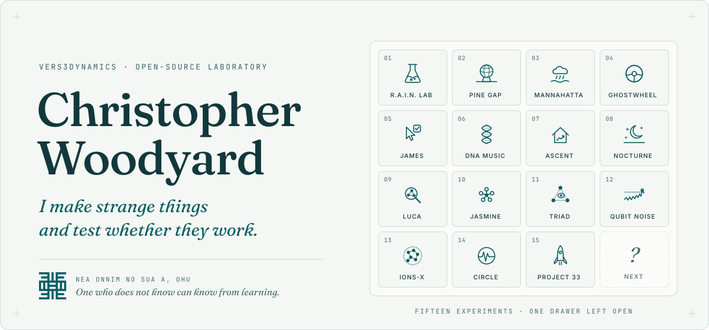
</picture></a>

I'm **Christopher Woodyard**, a researcher, artist, musician, writer and educator near Washington, DC. I run **[Vers3Dynamics](https://vers3dynamics.com/)**, an independent laboratory whose experiments are software you can open: worlds where people and AI agents play by the same rules, instruments that turn invisible patterns into sound, and practical tools that show their evidence. Then I try to find out where each one breaks.

> **AI is getting better at answering questions. We're working on making it better at knowing which answers deserve to be trusted.**

**Start somewhere strange:** [drive Pine Gap at midnight ↗](https://geotwn.vercel.app/) · [hear a strand of DNA ↗](https://arpa-h.vercel.app/) · [make a car refuse a command ↗](https://ghostwheel-one.vercel.app/) · [find the lab hidden inside a city ↗](https://rainlabteam.vercel.app/)

[Choose a door](#choose-a-door) · [How the inventions connect](#how-the-inventions-connect) · [What the evidence says](#what-the-evidence-says) · [Every public project](#every-public-project) · [Join in](#join-in)

## Choose a door

Six ways in. Each door opens onto a room of working projects, from playable worlds to research instruments, and every one links to its source.

<a href="#play-a-world"><picture><source media="(prefers-color-scheme: dark)" srcset="assets/door-play-dark.svg"><source media="(prefers-color-scheme: light)" srcset="assets/door-play-light.svg">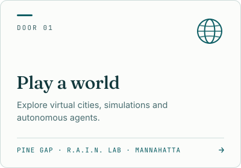</picture></a>
<a href="#challenge-an-intelligent-system"><picture><source media="(prefers-color-scheme: dark)" srcset="assets/door-challenge-dark.svg"><source media="(prefers-color-scheme: light)" srcset="assets/door-challenge-light.svg">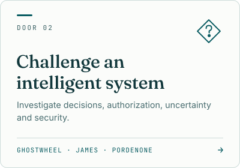</picture></a>
<a href="#hear-the-invisible"><picture><source media="(prefers-color-scheme: dark)" srcset="assets/door-hear-dark.svg"><source media="(prefers-color-scheme: light)" srcset="assets/door-hear-light.svg">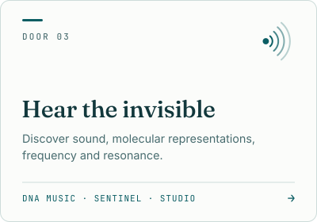</picture></a>
<a href="#explore-a-research-lab"><picture><source media="(prefers-color-scheme: dark)" srcset="assets/door-explore-dark.svg"><source media="(prefers-color-scheme: light)" srcset="assets/door-explore-light.svg">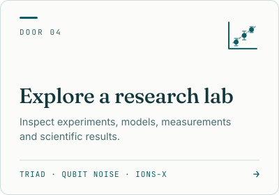</picture></a>
<a href="#use-something-practical"><picture><source media="(prefers-color-scheme: dark)" srcset="assets/door-use-dark.svg"><source media="(prefers-color-scheme: light)" srcset="assets/door-use-light.svg">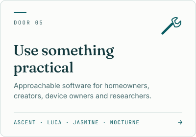</picture></a>
<a href="#discover-the-unusual"><picture><source media="(prefers-color-scheme: dark)" srcset="assets/door-discover-dark.svg"><source media="(prefers-color-scheme: light)" srcset="assets/door-discover-light.svg">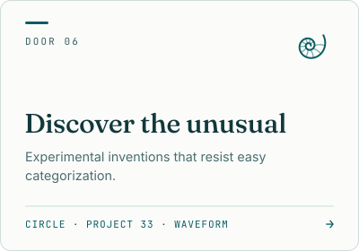</picture></a>

<a href="#play-a-world">Play a world</a> · <a href="#challenge-an-intelligent-system">Challenge an intelligent system</a> · <a href="#hear-the-invisible">Hear the invisible</a> · <a href="#explore-a-research-lab">Explore a research lab</a> · <a href="#use-something-practical">Use something practical</a> · <a href="#discover-the-unusual">Discover the unusual</a>

<picture><source media="(prefers-color-scheme: dark)" srcset="assets/rule-dark.svg"><source media="(prefers-color-scheme: light)" srcset="assets/rule-light.svg"></picture>

## Play a world

DOOR 01 · Explore virtual cities, simulations and autonomous agents.

### Pine Gap: After Hours

**What does an AI do with the keys to a truck at midnight?**

A fictional night shift at a public-source reconstruction of Pine Gap: collect a coffee, drive it across the site without spilling it, decode a numbers station, and tune four terminals before a midnight concert. A person, a scripted policy and an AI agent all reach this world through **the same controls and the same physics**, so the world, not the agent, decides what happened, and every run leaves a trace you can compare. My own music plays on the radio.

The scripted baseline (no AI model), re-rendered frame by frame and shown at 10× speed; the coffee leg takes 87.5 s. The site is built from published surveys and public imagery, and every gameplay event is invented. [Smaller MP4](https://github.com/topherchris420/satellite-vision-scape/blob/3457607680492edf4e4c9117859429846695f10c/docs/media/agent-drive.mp4).

`PLAYABLE WORLD` &nbsp;browser, no install · [**Play now →**](https://geotwn.vercel.app/) · [Watch the scripted baseline](https://geotwn.vercel.app/?controller=mock) · [Source](https://github.com/topherchris420/satellite-vision-scape)

<b>Under the hood:</b> shared controls, recorded runs, kept failures

- **What's distinctive.** Agents never touch the world's state. Their validated intents become the same per-frame input a keyboard produces, 120 Hz physics decides the outcome, and every session exports a trace that keeps intention, executed control, outcome and success apart. A small harness replays paired, seeded episodes and judges each prediction by fixed rules, so *not supported* is an ordinary answer.
- **What was recorded.** One complete live run by TypeSafe's Jev agent on 27 September 2026: 212 decisions in 457.8 s, all of the coffee delivered, no collisions, no human intervention. Six paired scripted experiments, in which 11 of 15 predictions held and 4 did not.
- **What failed.** An earlier live run looped at one terminal for 473 decisions and was stopped by hand. A later live run finished its task but hit a pedestrian.
- **What isn't claimed.** One complete run is an existence proof, not a success rate. Live Jev is not enabled on the public site.

[Experiment method](https://github.com/topherchris420/satellite-vision-scape/blob/main/docs/EXPERIMENTS.md) · [A recorded live run](https://github.com/topherchris420/satellite-vision-scape/blob/64640fb80bba7c7fc15eb7e04e99c202c29e6654/docs/traces/jev-free-roam-borrowed-wheels-live-2026-10-03.json)

<!-- ledger:pine-gap -->
Evidence ladder: `EXECUTABLE` · `OBSERVED` (recorded live-agent case studies and paired scripted experiments; simulated world).

### R.A.I.N. Lab, hidden in Lop Nur Twin

**What does research look like when an AI may propose an experiment but never decide whether it counts?**

Inside a public-source reconstruction of a desert airfield is a simulated city, and inside the city is a research lab. Four perspectives (James, Jasmine, Luca and Elena) take a question apart and quote the exact line each one relied on. A local model may propose an experiment; host code decides what runs, replays every result, and keeps the model's reading apart from the verdict.

Actual captures from the lab's offline engine: a scripted meeting (no model ran) and a simulated experiment record with replay verification.

`PLAYABLE · RESEARCH RUNS LOCALLY` · [**Enter the lab →**](https://rainlabteam.vercel.app/) · [Walk the twin](https://lop-nur-twin.vercel.app/) · [Play Noeterra](https://lop-nur-twin.vercel.app/noeterra) · [Source](https://github.com/topherchris420/lop-nur-twin)

<b>Under the hood:</b> a model proposes, the host decides

- **What's distinctive.** A model's words never enter what runs. Its proposal must match a design the host wrote, identified by hash in a charter a person authorized. Matched control and treatment arms then run on fresh simulators, are re-simulated immediately, and enter a registry that keeps the model's interpretation separate. The same discipline covers a crowd simulator, a driven oscillator checked against its exact solution, and Noeterra, a deterministic civilization engine written in Rust and compiled to WebAssembly.
- **What failed.** The first live-model experiment, designed by Gemma, ran and replayed, then missed both preregistered accuracy guards against the analytic solution, so its verdict stayed *inconclusive*. Local Qwen sessions never completed a scientific cycle within their time budgets.
- **What isn't claimed.** Simulated results describe simulator agents, not real people, a real airfield or general scientific intelligence. The airfield is an unclassified public-source reconstruction, not operational intelligence.
- **History.** The original runtime, [`james_library`](https://github.com/topherchris420/james_library), is archived. Its [migration record](https://github.com/topherchris420/lop-nur-twin/blob/main/docs/RAIN_MIGRATION.md) documents the port, and its older results remain historical evidence.

[The Gemma record](https://github.com/topherchris420/lop-nur-twin/blob/b8400fdf3f676d6ee9e090760921eff7c419df22/docs/rea-research/evaluations/gemma-live/README.md) · [Evidence and limits](https://github.com/topherchris420/lop-nur-twin/blob/main/docs/RAIN_SCIENTIFIC_AUTONOMY.md)

<!-- ledger:lop-nur -->
Evidence ladder: `EXECUTABLE` · `OBSERVED` (scripted and live-model-designed simulator experiments; no physical or general scientific validation).

<!-- ledger:rain-lab -->
Historical evidence ladder, `james_library`: `EXECUTABLE` · `OBSERVED` (seeded quotation checks and simulated controls; same-seed reruns).

### Mannahatta

**What if you could send the same storm through a different city?**

<a href="https://phaseroot.vercel.app/">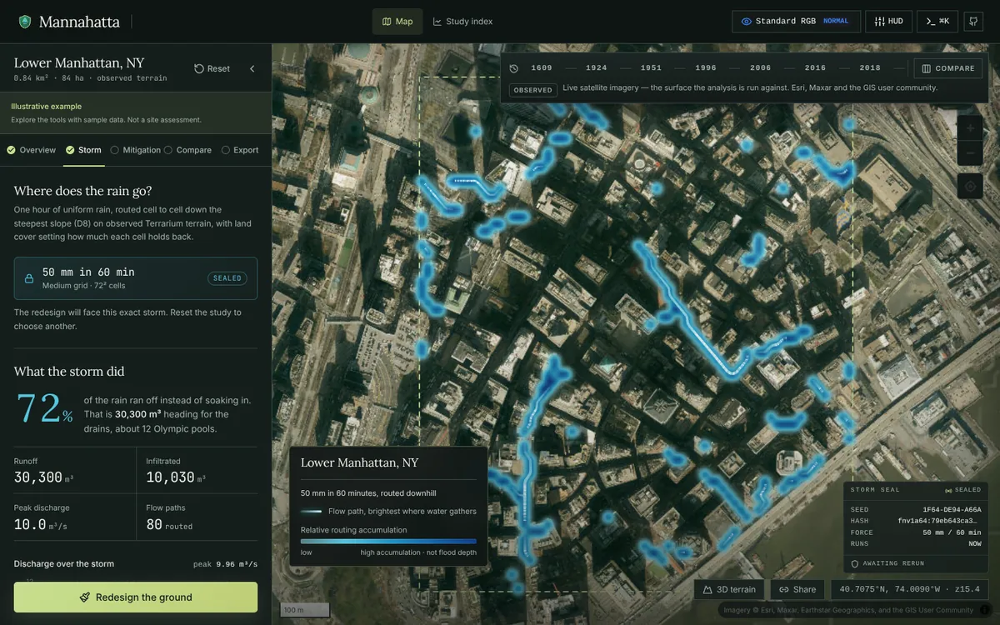</a>

Three frames of one place: its historical ecology (Manhattan in 1609, land shaped by the Lenape), its present land cover, and a redesign you draw. Hold the storm and the terrain fixed, plant trees or a bioswale, and compare where the modeled water goes. The question, assumptions, drawings and results export together, and reopening a study checks its identities and reruns the comparison.

Captured from the public app on 21 October 2026: its built-in illustrative example (sample land cover, not a site assessment) after a sealed 50 mm storm. Bright paths show where this model sends water, not where flooding is likely. Basemap imagery © Esri, Maxar, Earthstar Geographics.

`LIVE WEB APP · PLANNING ESTIMATES` · [**Explore a place →**](https://phaseroot.vercel.app/) · [Source](https://github.com/topherchris420/cognisync-terrain-weaver)

<b>Under the hood:</b> a controlled counterfactual, and a forecast that failed

- **What's distinctive.** The useful artifact is the controlled counterfactual you can export and replay: question, assumptions, drawings, terrain, data identity and routed outcomes travel together.
- **What failed.** Of 15 recorded experiments, 7 did not support their claim. In the preregistered holdout on a September 2023 New York storm (145 street-flooding reports), routed water located the reports no better than chance (AUC 0.50), while simply ranking low ground did better (0.62).
- **What isn't claimed.** It is not a flood forecast. Land-cover classification and fixed-coefficient hydrology are limited, and the app says so beside every routed map.

[Experiment index](https://github.com/topherchris420/cognisync-terrain-weaver/blob/3dbcdd769f0bfa74de6f45ebf229e6552f94578b/experiments/INDEX.md) · [The holdout report](https://github.com/topherchris420/cognisync-terrain-weaver/blob/d797b189f7e2d8df9fa75df26e77246e52da0210/experiments/routing/R5-311-association-holdout/REPORT.md)

<!-- ledger:mannahatta -->
Evidence ladder: `EXECUTABLE` · `OBSERVED` · `NOT SUPPORTED` (model checks and public-data comparisons; the holdout flood-report hypothesis failed).

**Also in this room**

- **[Noeterra](https://lop-nur-twin.vercel.app/noeterra)**: rule a nation in a deterministic civilization engine, written in Rust and compiled to WebAssembly, while other nations follow their own rule-based policies. It lives inside Lop Nur Twin; public play uses no model.
- **[Orpheus](https://parsonscorporation.vercel.app/)**: interactive command-room fiction. Commit decisions against generated events, then review their consequences in an after-action log. Only your choices, and your microphone's loudness if you opt in, are real input. [Source](https://github.com/topherchris420/orpheus-resonance-protocol)

<picture><source media="(prefers-color-scheme: dark)" srcset="assets/rule-dark.svg"><source media="(prefers-color-scheme: light)" srcset="assets/rule-light.svg"></picture>

## Challenge an intelligent system

DOOR 02 · Investigate decisions, authorization, uncertainty and security.

### GHOSTWHEEL

**What happens when a car refuses a command?**

<a href="https://ghostwheel-one.vercel.app/">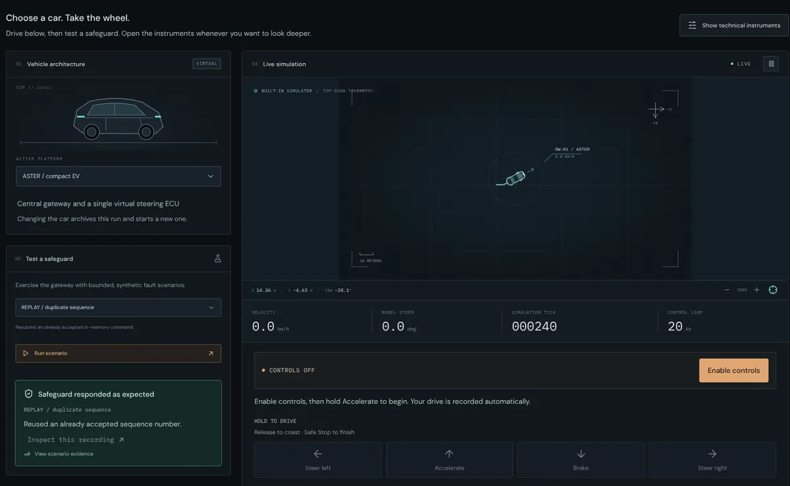</a>

Enter an interactive electric-vehicle security laboratory and investigate the decisions between an instruction and a simulated physical response. Drive one of three fictional cars, inject one of nine synthetic faults (a replayed command, a stale one, an invalid identity, competing pedals) and watch a command gateway accept or refuse it, request a virtual safe state, and write the event into a hash-chained record you can replay.

Captured from the public simulator on 21 October 2026: after a short drive, a replayed steering command is refused because it reused an already accepted sequence number. Fictional vehicles and synthetic frames; no real car, CAN device or OBD port is connected.

`LIVE WEB APP · SIMULATION ONLY` · [**Take the wheel →**](https://ghostwheel-one.vercel.app/) · [Source](https://github.com/topherchris420/ghostwheel)

<b>Under the hood:</b> one model, two languages, no path to a real car

- **What's distinctive.** The vehicle model exists twice, in Python and as a TypeScript port that reimplements Python's seeded random-number generator, and a parity check confirms that their trajectories, frames and verdicts agree. A connector registry refuses any actuation transport other than simulation.
- **What isn't claimed.** No vulnerability in any real vehicle. It is not a penetration-testing tool, and its measurements describe the model, not real-world vehicle safety. The desktop edition and the simulator bridges are not yet validated end to end.

<!-- ledger:ghostwheel -->
Evidence ladder: `EXECUTABLE` · `BUILDING` (browser simulator, simulation only; desktop edition and simulator bridges not yet validated).

### James

**What if your AI assistant had to ask before every click?**

A desktop companion that talks to a model running on your own computer, looks at your screen only when you press a button, and proposes one exact click or keystroke at a time, which you approve before it happens and check afterwards. It can read the R.A.I.N. Lab's records; it cannot steer the lab.

A real session, not a mockup: James 0.4.0 on Linux with Gemma 3 4B running in Ollama on the same computer. The reply is the model's own.

`DESKTOP PREVIEW · WINDOWS, MACOS, LINUX` · [**Get started →**](https://github.com/topherchris420/james/blob/main/docs/GETTING_STARTED.md) · [Download the preview](https://github.com/topherchris420/james/releases) · [Source](https://github.com/topherchris420/james)

<b>Under the hood:</b> the model talks; you hold the keys

- **What's distinctive.** Its network client can address only a loopback port on your own machine, and it warns you when your model app reports a cloud model. Voice can never approve an action, and a delayed approval expires before it can be used.
- **What isn't shown yet.** No reviewed click or keystroke has reached a real application in 0.4.0 testing, Windows and macOS installs have not been run by a person, and the downloads are unsigned.
- **What failed.** In an earlier session, small models said a simulator finding was real-world evidence, or claimed an authority they did not have. [Session record](https://github.com/topherchris420/james/blob/31cdff1822b2026a916cb582d7be97afc7037d2f/docs/VALIDATION.md#readme-screenshot-session-2026-10-11)

<!-- ledger:james -->
Evidence ladder: `EXECUTABLE` (desktop preview; recorded Linux-container model sessions and platform CI, not general end-user validation).

**Also in this room**

- **[Pordenone · Resonate AI Mesh](https://resonate-ai-bridge.vercel.app/)**: a deterministic kernel in which simulated agents propose actions and checks decide. Approved proposals are checked again before commit, so a stale observation can still stop them, and hash-chained records replay every decision. In one pre-registered simulation, routing judgment only to agents that looked unstable let more commits through on degraded evidence, and that claim is recorded as contradicted. [Source](https://github.com/topherchris420/resonate-ai-mesh) 
  <!-- ledger:pordenone -->
  Evidence: `EXECUTABLE` · `OBSERVED` · `NOT SUPPORTED` (simulated telemetry; seeded experiments with mock judges; a pre-registered routing claim failed).

<picture><source media="(prefers-color-scheme: dark)" srcset="assets/rule-dark.svg"><source media="(prefers-color-scheme: light)" srcset="assets/rule-light.svg"></picture>

## Hear the invisible

DOOR 03 · Discover sound, molecular representations, frequency and resonance.

### DNA Music Molecules

**What does a strand of DNA sound like?**

<a href="https://arpa-h.vercel.app/">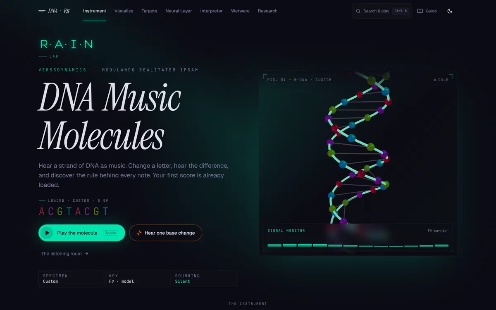</a>

Turn biological sequences into music, change the rules of interpretation, and inspect how each note was created. Load a complete gene from NCBI or type your own strand, choose a lens (one base per note, base pairs, codons), then change a single letter and hear the difference. Every note can name the rule that produced it, and sessions export as MIDI or WAV.

Captured from the public instrument on 21 October 2026. The pitches are a mapping chosen for listening, not sounds made by DNA. The source code is not public yet.

`LIVE INSTRUMENT · SOURCE NOT YET PUBLIC` · [**Play a strand →**](https://arpa-h.vercel.app/)

<b>Under the hood:</b> the mapping is the experiment

- **What's distinctive.** Versioned lenses make the rule of interpretation an experimental variable: the same strand sounds different through each lens, and mutate-and-compare isolates the effect of one letter. The instrument labels what is mapped and what is art: its helix follows the strand, while its other views are renderings of the live sound.
- **What isn't claimed.** DNA makes no sound; these pitches are a mapping. Its research notes on morphic resonance explain why mainstream biology does not accept that idea. The AI interpreter is not configured on the public site.

<table>
<tr>
<td width="50%" valign="top">

**[Dynamic Resonance Rooting](https://dynamic-resonance-rooting.vercel.app/)** 
LIBRARY · LIVE LAB IN THE BROWSER

<a href="https://dynamic-resonance-rooting.vercel.app/">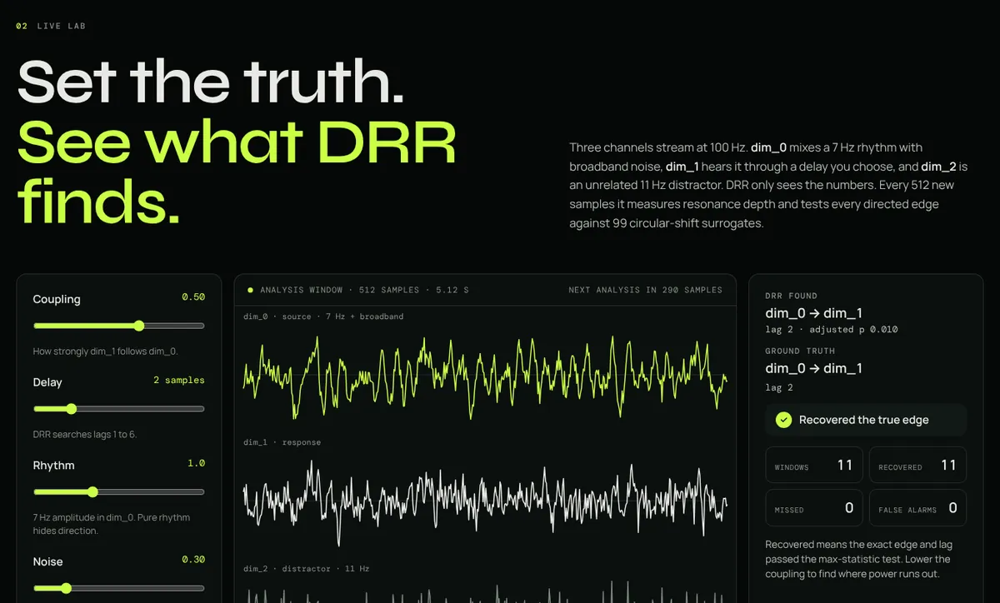</a>

*When one signal seems to lead another, is that a real lag or memory in the noise?* Plant a rhythm and a delay, and watch DRR test every direction against surrogate nulls, live in your browser. Its own preregistered test on stratospheric wind data failed, and that result sits on its front page.

<!-- ledger:drr -->
Evidence: `OBSERVED` (synthetic calibration) · `NOT SUPPORTED` (preregistered external structural-change test). [Source](https://github.com/topherchris420/dynamic-resonance-rooting)

</td>
<td width="50%" valign="top">

**[Sentinel](https://hello-goodbye-iota.vercel.app/)** 
LIVE WEB APP · NO ACCOUNT

<a href="https://hello-goodbye-iota.vercel.app/">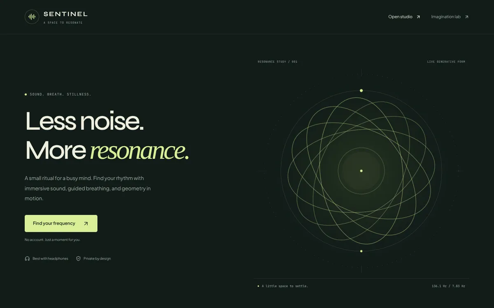</a>

*Less noise. More resonance.* An account-free studio of stereo tones, noise and a paced breathing guide, with geometry that follows your settings. It measures nothing about your body and claims no therapeutic effect, and your session record stays on your device.

[Source](https://github.com/topherchris420/resonance-flow-nexus)

</td>
</tr>
</table>

**Also in this room**

- **[Vers3Dynamics Studio](https://bell-labs.vercel.app/)**: a browser synthesizer you play by scratching a virtual record, with visuals that react to the sound. Its pattern editor is on screen but not yet connected to the sound, a gap the project states itself. [Source](https://github.com/topherchris420/quantum-spin-sound)
- **[Indigo People](https://chriswoodyard.bandcamp.com/)**: my recordings, including the album that plays on Pine Gap's radio.

<picture><source media="(prefers-color-scheme: dark)" srcset="assets/rule-dark.svg"><source media="(prefers-color-scheme: light)" srcset="assets/rule-light.svg"></picture>

## Explore a research lab

DOOR 04 · Inspect experiments, models, measurements and scientific results.

### TRIAD

**When should a system refuse to answer?**

TRIAD began with a simulated four-electrode sensor and an unsettling audit: half of its large position errors arrived with a successful "converged" flag. It grew into a Rust instrument for selective risk (how often the answers a system chooses to give are wrong) and a series of frozen, pre-registered studies. Most of them came back negative, and every one is archived beside the code that produced it.

Genuine output from TRIAD's verifier: Milestone 7 on UCI Bike Sharing. In the bottom-right panel, TRIAD's evidence-qualified decisions cost more than standard monitoring, a negative result.

`RESEARCH INSTRUMENT · RUST` · [**Score your own predictions →**](https://github.com/topherchris420/triad#start-with-the-evidence) · [Follow the research arc](https://github.com/topherchris420/triad#the-research-arc-machine-checked) · [Source](https://github.com/topherchris420/triad)

<b>Under the hood:</b> frozen tests, honest losses

- **What's distinctive.** A claims ledger binds every headline number in its README to a field in an archived result file, and CI fails if the prose drifts. Studies are frozen before data and re-checked by separately written verifiers. Selective risk itself is an established metric; TRIAD is one implementation of it.
- **What failed.** In Milestone 8, on 5,078 claims whose truth came from held-out outcomes, TRIAD's evidence rules cost 0.159, against 0.121 for a blind statistical reviewer and 0.125 for endorsing nothing. The blind comparators were written by an AI agent of the same model family, and nothing has been adjudicated by a person.
- **What's newest.** In Milestone 9, a pre-registered simulation, established risk-control tests certified the same refusal guarantee with 2,500 or 1,000 sessions, against 25,000 for TRIAD's original controller. That is statistical engineering in simulation, not a sensor or real-data result.
- **Proposed elsewhere.** The metric was submitted to the NIST AI Metrology Center's public community process ([the proposal](https://github.com/topherchris420/ai-metrology-submissions/blob/ff442fdfa56cc2fe4b18e087a5c5e9b6559a8e49/submissions/selective-risk-at-target-coverage.yml)); it was not merged as of 21 October 2026, and no endorsement is implied.

[Milestone 8](https://github.com/topherchris420/triad/blob/7be64c8c93f2ef3238ac18b386aa5bb81c214bbb/docs/metrology/milestone8-results.md) · [Milestone 9](https://github.com/topherchris420/triad#milestone-9-certifying-refusal-with-far-less-data)

<!-- ledger:triad -->
Evidence ladder: `EXECUTABLE` · `OBSERVED` · `NOT SUPPORTED` (simulated sensor, frozen public-data studies and a Milestone 9 simulation; the pre-registered evidence-rule hypothesis failed).

### Quantum Noise Profiler

**Can a qubit monitor tell real drift from ordinary noise, and admit when it can't?**

<a href="https://github.com/topherchris420/quantum-noise-profiler#explore-the-real-hardware-data">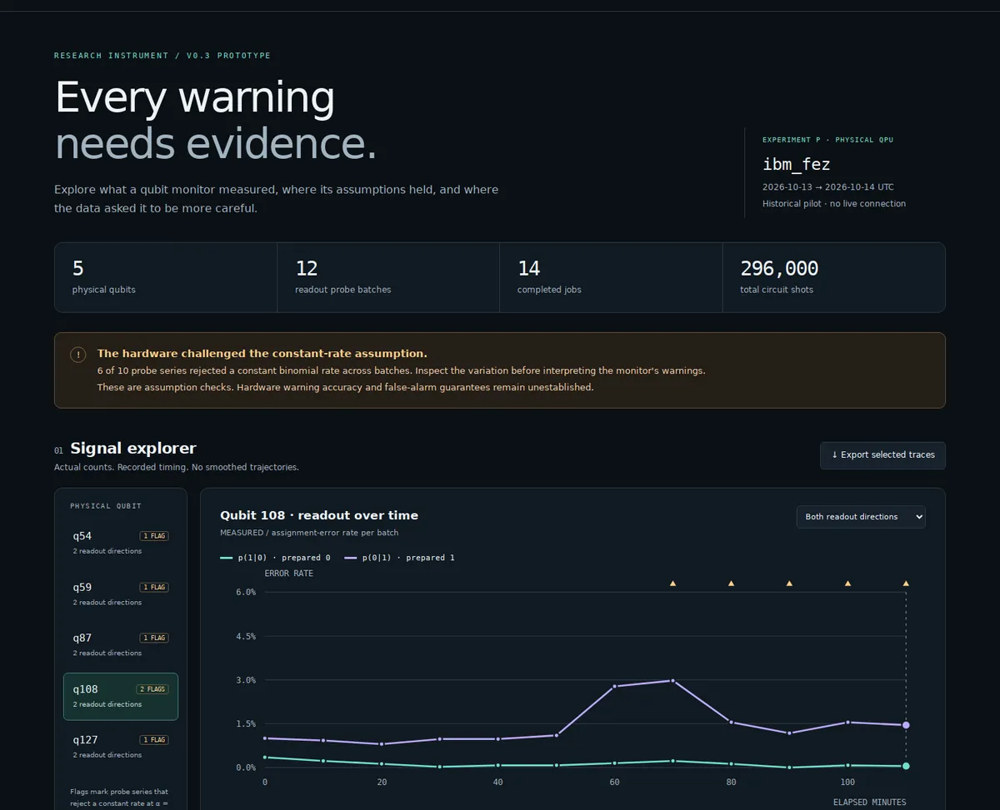</a>

Quantum Noise Profiler watches qubit error rates over time, attaches its evidence to every warning, and withholds estimates and forecasts its data cannot support. It keeps three kinds of numbers apart: what the vendor reports, what ordinary workloads imply, and what dedicated probes measure. Its first real-device run, a preregistered two-hour pilot on IBM's `ibm_fez`, tested the method's own assumptions: readout held steady within each sweep, but in 6 of 10 probe series it drifted between batches more than the model allows.

The project's offline evidence explorer replaying that pilot (13–14 October 2026; 5 qubits, 296,000 shots), cropped from its own screenshot. Whether the recorded alerts were true or false is unknown.

`RESEARCH INSTRUMENT · PYTHON` · [**Explore the hardware data →**](https://github.com/topherchris420/quantum-noise-profiler#explore-the-real-hardware-data) · [Results and limits](https://github.com/topherchris420/quantum-noise-profiler/blob/192a8a0362dc9738b5bbb4a8f145447c1221c96a/results/V03_SUMMARY.md) · [Source](https://github.com/topherchris420/quantum-noise-profiler)

<b>Under the hood:</b> every warning carries its evidence

- **What's distinctive.** Separate series for vendor, workload and probe values; sequential tests under a declared session error budget, with the type of guarantee stated per channel; every result preregistered, hash-manifested and recomputed from raw data.
- **What failed.** In simulation, a calibrated conventional CUSUM matched the new engine: in the project's words, "the operational gain comes from monitoring readout probes and acting on early warnings, not from the e-process." On hardware, the constant-rate assumption failed.
- **What isn't claimed.** Hardware warning accuracy is not established. One device, two hours, and no affiliation with IBM.

<!-- ledger:qnp -->
Evidence ladder: `EXECUTABLE` · `OBSERVED` · `SUPPORTED` · `NOT SUPPORTED` (preregistered simulations and one two-hour hardware pilot: its within-sweep stability check passed and its constant-rate check failed).

**Also in this room**

- **[IONS-X Deep Emergence Lab](https://github.com/topherchris420/ions-x-deep-emergence-lab)**: forty simulated sensing agents search a synthetic field for planted couplings, and every run is paired with an identical run that has none. Version 0.5 audited its own generator, found the field had frozen, and superseded the earlier results. 
  <!-- ledger:ions-x -->
  Evidence: `OBSERVED` (synthetic field; associations, not causation).
- **[rain-pipeline](https://github.com/topherchris420/rain-pipeline)**: commits an experiment's pass-and-fail rules before held-out heart-and-breathing recordings are read, then lets anyone replay the verdict. Its front page leads with the hypothesis that failed.

<picture><source media="(prefers-color-scheme: dark)" srcset="assets/rule-dark.svg"><source media="(prefers-color-scheme: light)" srcset="assets/rule-light.svg"></picture>

## Use something practical

DOOR 05 · Approachable software for homeowners, creators, device owners and researchers.

### Project Ascent

**Your home has a story behind its price.**

Explore property evidence, question valuation assumptions, and understand financial decisions without a subscription. For covered homes in DC and two Maryland counties, Ascent shows every recorded sale behind an estimate, lets you exclude a comparable or change a condition rating and watch the number move, and compares selling, renting, refinancing or renovating with your own numbers.

An automated capture from Ascent's own test suite, on its clearly fictional sample home: six adjusted comparable sales around one estimate, shown as an observed range rather than a confidence interval.

`LIVE WEB APP · FREE · NO ACCOUNT` · [**Try Ascent →**](https://project-ascent-theta.vercel.app/) · [Published accuracy tests](https://project-ascent-theta.vercel.app/accuracy) · [Source](https://github.com/topherchris420/project-ascent)

<b>Under the hood:</b> the failed studies stay published

- **What's distinctive.** Each market model is scored once, against thresholds fixed in code before a held-out year of recorded sales, and the failed studies stay published next to the one that passed.
- **What the tests found.** The DC single-family and rowhouse model met all 9 criteria (median error 9.98% on 2,254 sales), three of them narrowly. DC condominiums met 4 of 9, the two Maryland models 4 and 8 of 9, and a King County backtest 5 of 9.
- **What isn't claimed.** Not an appraisal, not financial advice, no MLS feed, and AI does not set prices. A median error describes a tested group, not your home.

<!-- ledger:project-ascent -->
Evidence ladder: `EXECUTABLE` · `OBSERVED` · `SUPPORTED` · `NOT SUPPORTED` (five pre-registered holdout studies on recorded sales: the DC house model passed, narrowly in places; four others did not).

### Luca

**What does a phone reveal about itself through its traffic alone?**

Join a phone, laptop or smart gadget to the Wi-Fi network Luca creates, use it normally, then read a report of every destination it reached, graded against indicator lists and heuristics, with nothing installed on the device. Luca is built on Kaspersky's open-source TinyCheck and adds a kernel observatory that counts the device's flows independently of the packet capture, so the report can say whether the capture was complete and how each statement is known.

Captured from the read-only public demo on 21 October 2026: a synthetic sample session with invented traffic. The demo captures nothing and controls no Wi-Fi.

`EXECUTABLE PROTOTYPE · DEDICATED LINUX HOST` · [**See a sample report →**](https://luca-rho-five.vercel.app/) · [Source](https://github.com/topherchris420/Luca)

<b>Under the hood:</b> network evidence, labelled by how it is known

- **For authorized use.** Inspect only devices and networks you own or are authorized to assess. A match is evidence to investigate, not proof of compromise. Luca sees network traffic only: no apps, files or memory, and no decryption.
- **What isn't shown yet.** The observatory has run in CI virtual machines, not yet on Wi-Fi hardware, and its preregistered experiments have no published results.

<!-- ledger:luca -->
Evidence ladder: `EXECUTABLE` (TinyCheck-derived appliance and a kernel observatory tested in CI virtual machines; synthetic public demo).

<table>
<tr>
<td width="50%" valign="top">

**[Jasmine](https://github.com/topherchris420/Jasmine)** 
EXECUTABLE PROTOTYPE · SELF-HOSTED

*Can one sentence become an AI workflow that runs on your own machine?* Ask for "a chatbot that answers questions about my PDFs": Jasmine proposes the steps, checks that your model and documents are ready, and builds nothing until you approve. Test it against a model on your own computer, then deploy it as an API, chat widget or schedule.

<!-- ledger:jasmine -->
Evidence: `EXECUTABLE` (self-hosted; the answer shown came from a small local model).

</td>
<td width="50%" valign="top">

**[Nocturne](https://github.com/topherchris420/nocturne)** 
EXECUTABLE PROTOTYPE · PYTHON

<a href="https://github.com/topherchris420/nocturne">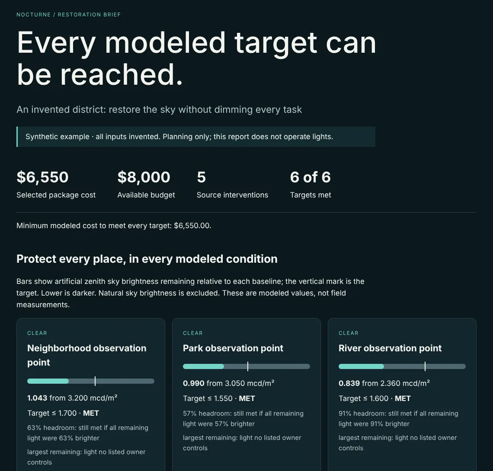</a>

*How dark could the night get, and what is the cheapest way there?* Set a sky-brightness target for a park or a street, list what each owner could change, and Nocturne finds the least-cost combination that meets the target in every weather scenario, or says none can. It controls no lights.

<!-- ledger:nocturne -->
Evidence: `EXECUTABLE` (its own offline report on an invented district; all inputs invented).

</td>
</tr>
</table>

**Also in this room**

- **[Anna · R.A.I.N. DataMatrix Engine](https://github.com/topherchris420/anna)**: a self-hostable search engine for papers, standards, code and vendor documentation that fuses keyword and vector retrieval and cites the exact passage. Built on the Anna's Archive codebase. A valid citation does not establish factual support. 
  <!-- ledger:anna -->
  Evidence: `EXECUTABLE` (self-hosted search; no retrieval evaluation yet).
- **[Embedded AI Validation Platform](https://github.com/topherchris420/embedded-ai-validation-platform)**: release gates for firmware and TinyML builds, with fault injection and run-to-run comparison. 
  <!-- ledger:eaiv -->
  Evidence: `EXECUTABLE` (every committed result comes from simulated targets).

<picture><source media="(prefers-color-scheme: dark)" srcset="assets/rule-dark.svg"><source media="(prefers-color-scheme: light)" srcset="assets/rule-light.svg"></picture>

## Discover the unusual

DOOR 06 · Experimental inventions that resist easy categorization.

### CIRCLE

**Can a biofeedback loop prove what it actually did?**

A closed-loop instrument, designed in code, that senses the body and answers with gentle haptic cues. Raw sensor codes become estimates, estimates inform bounded decisions, and an independent observation checks whether the intended cue actually happened. Timing, gaps, refusals and consent belong to one record, tested against a simulated physiology twin whose truth is known.

Left, a concept render of the planned Rev B hardware geometry, not footage of a device. Right, traces recovered from simulated physiology, not a human recording. Nothing has been fabricated, and the design is not cleared for fabrication or for connection to a person.

`HARDWARE DESIGN · SIMULATED PHYSIOLOGY` · [**Run the physiology twin →**](https://github.com/topherchris420/circle#quick-start) · [Source](https://github.com/topherchris420/circle)

<b>Under the hood:</b> a command is not an outcome

- **What's distinctive.** Issuing a haptic command and observing a haptic onset are separate events, and every controller decision can be rebuilt from raw data.
- **What failed.** The twin's benchmark passed 999 of 1,000 checks; one seed missed the skin-conductance sensitivity threshold, and that failure stays in the record.
- **What isn't claimed.** No human recordings, no fabricated board, and no electrical-safety or clinical claim. The boards are unrouted and every review gate is open.

<!-- ledger:circle -->
Evidence ladder: `OBSERVED` (simulated physiology) · `BUILDING` (hardware design).

<table>
<tr>
<td width="50%" valign="top">

**[Project 33](https://topherchris420.github.io/33/)** 
BENCH PROTOTYPE · NO FLIGHT CLAIMED

<a href="https://topherchris420.github.io/33/">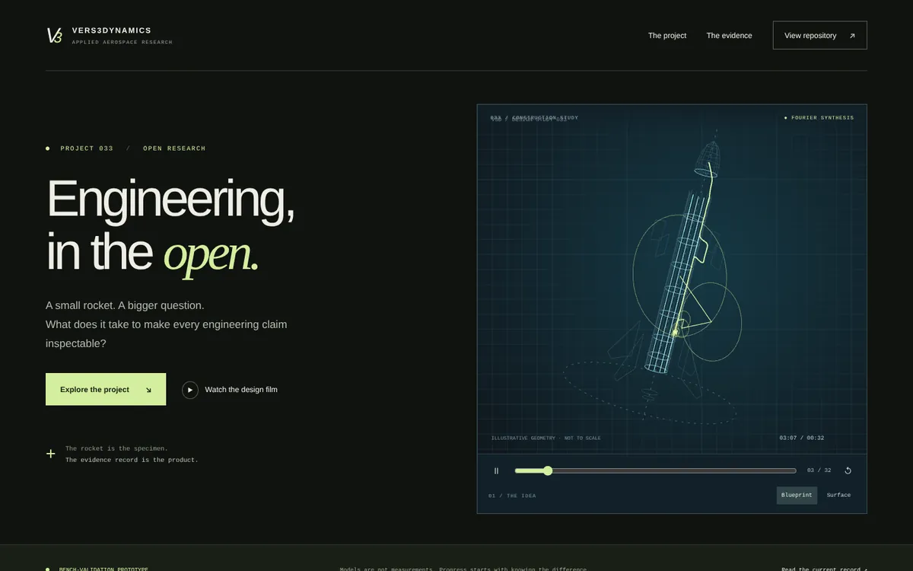</a>

*How much of a rocket can be checked before anything flies?* A small folding-fin testbed where every engineering claim is tied to the artifacts that support it and the measurements still missing. Its own models currently contradict 3 of its 8 claims, and it says so up front.

<!-- ledger:project-33 -->
Evidence: `BUILDING` (no accepted physical measurement yet). [Source](https://github.com/topherchris420/33)

</td>
<td width="50%" valign="top">

**[Waveform](https://waveform-teleportation.vercel.app/)** 
LIVE WORKSTATION · SOURCE NOT PUBLIC

<a href="https://waveform-teleportation.vercel.app/">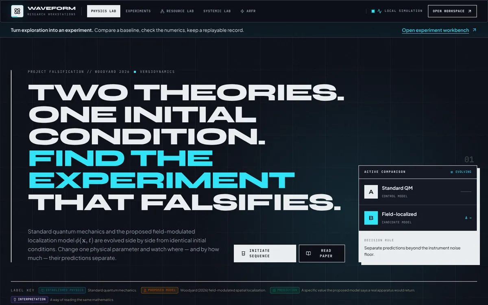</a>

*Two theories, one starting point: which experiment would tell them apart?* Standard quantum mechanics and a proposed field model evolve side by side; change one parameter and see where their predictions separate. Everything is computed in your browser from analytical models; nothing is measured data, and the proposed model is untested physics.

<!-- ledger:woodyard-workstation -->
Evidence: `EXECUTABLE` (public browser workstation; its source is private).

</td>
</tr>
</table>

**Also in this room**

- **[hello_os](https://github.com/topherchris420/ideas)**: a toy model of spinning-rotor gravitomagnetism, with stress-limited design sweeps and synthetic detector traces. Nothing was built, and nothing was measured.
- **[Dynamic Location Theory](https://doi.org/10.5281/zenodo.18263032)**: a preprint proposing that position is encoded through resonance with a background field, with predictions for atomic clocks and matter-wave interferometers. Untested.

<picture><source media="(prefers-color-scheme: dark)" srcset="assets/rule-dark.svg"><source media="(prefers-color-scheme: light)" srcset="assets/rule-light.svg"></picture>

## How the inventions connect

<picture>
<source media="(prefers-color-scheme: dark)" srcset="assets/chain-dark.svg">
<source media="(prefers-color-scheme: light)" srcset="assets/chain-light.svg">

</picture>

Vers3Dynamics explores how intelligent systems make decisions, how those decisions are evaluated, and when uncertainty should prevent action. The projects are separate systems, built and tested on their own terms; they are not one integrated architecture. But they keep circling the same six questions from different directions.

| Stage and question | Where to see it |
| --- | --- |
| **Observation** *What is actually there?* | [CIRCLE](#circle) · [Luca](#luca) · [Quantum Noise Profiler](#quantum-noise-profiler) |
| **Interpretation** *What might it mean?* | [DNA Music Molecules](#dna-music-molecules) · [R.A.I.N. Lab](#rain-lab-hidden-in-lop-nur-twin) · [Dynamic Resonance Rooting](#hear-the-invisible) |
| **Decision** *Is the evidence enough to act?* | [TRIAD](#triad) · [James](#james) · [Pordenone](#challenge-an-intelligent-system) |
| **Action** *What does the system actually do?* | [Pine Gap](#pine-gap-after-hours) · [GHOSTWHEEL](#ghostwheel) · [Nocturne](#use-something-practical) |
| **Measurement** *What happened, and how sure are we?* | [Quantum Noise Profiler](#quantum-noise-profiler) · [Project Ascent](#project-ascent) · [IONS-X](#explore-a-research-lab) |
| **Verification** *Would it hold up again?* | [rain-pipeline](#explore-a-research-lab) · [Mannahatta](#mannahatta) · [Project 33](#discover-the-unusual) |

When the evidence runs out, the honest move is to stop: TRIAD abstains, James asks, GHOSTWHEEL's gateway refuses.

> **Intelligence may propose. Evidence must be checked. Authority stays with the human.**

<picture><source media="(prefers-color-scheme: dark)" srcset="assets/rule-dark.svg"><source media="(prefers-color-scheme: light)" srcset="assets/rule-light.svg"></picture>

## What the evidence says

The point is to build things that can tell me when I am wrong. Every featured project carries a state from the [public ledger](experiments/README.md): what runs, what was recorded and under which conditions, and which claims failed a test stated in advance. Failed tests stay on the record, even after later work improves the method.

<b>Open twelve findings, the failures included, with their sources</b>

- **R.A.I.N.:** The live Gemma oscillator experiment replayed successfully but failed both analytical accuracy guards, so its conclusion stayed inconclusive. [Record](https://github.com/topherchris420/lop-nur-twin/blob/b8400fdf3f676d6ee9e090760921eff7c419df22/docs/rea-research/evaluations/gemma-live/README.md). Historically, the quotation gate also rejected genuine quotes after typography normalization. [Archived failure](https://github.com/topherchris420/james_library/blob/9c8811e343d21b8c143055f9cf549abdefa862f1/RESULTS.md).
- **Quantum Noise Profiler:** In simulation, the follow-up repaired two earlier failure modes, but a calibrated CUSUM matched its operational performance. On IBM hardware, the preregistered within-sweep stability check passed and the constant-rate check failed in 6 of 10 series. [Results](https://github.com/topherchris420/quantum-noise-profiler/blob/192a8a0362dc9738b5bbb4a8f145447c1221c96a/results/V03_SUMMARY.md).
- **Mannahatta:** Routed accumulation did not locate held-out flood reports better than low elevation. The map's usefulness as a question does not validate it as a forecast. [Holdout](https://github.com/topherchris420/cognisync-terrain-weaver/blob/d797b189f7e2d8df9fa75df26e77246e52da0210/experiments/routing/R5-311-association-holdout/REPORT.md).
- **TRIAD:** On 5,078 outcome-grounded claims, its decision cost was 0.159, versus 0.121 for the blind statistical reviewer and 0.125 for endorsing nothing. The same-model-family AI comparators and the lack of human adjudication limit the test. [Milestone 8](https://github.com/topherchris420/triad/blob/7be64c8c93f2ef3238ac18b386aa5bb81c214bbb/docs/metrology/milestone8-results.md).
- **Project Ascent:** Four of its five pre-registered price studies missed acceptance on held-out recorded sales: DC condominiums, both Maryland models and a King County backtest. [Accuracy studies](https://github.com/topherchris420/project-ascent/blob/698e8fe8a345bf9a5522a0d8031a230775c14182/docs/valuation-validation.md).
- **DRR:** Its preregistered NOAA QBO structural-change comparison exceeded the permitted false-alarm rate. [External evidence](https://github.com/topherchris420/dynamic-resonance-rooting/blob/862c4f75e6092e3314eb786adcb9fa2a7ee3e779/docs/external-evidence.md).
- **IONS-X:** An audit of its own synthetic generator found that the field behind every earlier result froze and made its "transient" coupling permanent; on the repaired field, the transient coupling did not clear the family-wise bar. [Version 0.5](https://github.com/topherchris420/ions-x-deep-emergence-lab/blob/99401c3e1a6ceed3f63cc8e3e606f164e13ff245/README.md#what-version-05-found-in-its-own-generator).
- **Pordenone:** Routing model judgment only to agents that looked unstable saved 182 judgment calls per run and let 2.55 more commits through on degraded evidence, in simulation. [Experiments](https://github.com/topherchris420/resonate-ai-mesh/blob/8afc9de712331efdb1aece51ff60c7ca0dbb4244/docs/experiments.md).
- **James:** Earlier small-model sessions confused simulator findings with real-world evidence or claimed authority the model did not have. Later implementation checks do not erase those failures. [Historical session](https://github.com/topherchris420/james/blob/31cdff1822b2026a916cb582d7be97afc7037d2f/docs/VALIDATION.md#readme-screenshot-session-2026-10-11).
- **Pine Gap:** Paired scripted runs exposed a control-size failure: graded dial turns locked terminals; long holds did not. A later live Free Roam run completed its task but recorded a pedestrian collision. [Scripted experiment](https://github.com/topherchris420/satellite-vision-scape/blob/bff1f8095739d925a9e0bc13e3a6566cf2363d04/experiments/results/tuning-control-magnitude/report.md) · [Live trace](https://github.com/topherchris420/satellite-vision-scape/blob/64640fb80bba7c7fc15eb7e04e99c202c29e6654/docs/traces/jev-free-roam-borrowed-wheels-live-2026-10-03.json).
- **Project 33:** Its own models contradict 3 of its 8 engineering claims, including the torsion-spring margin (19% against a required 20%), and no physical measurement has been accepted. [Claim record](https://github.com/topherchris420/33/blob/2ad7213e5fea06d1f21a20c020ada15467199c8d/README.md).
- **Vers3Dynamics Studio:** The project's own test, editing one note and hearing the pitch change, fails today: its pattern editor is not yet connected to the sound. [README](https://github.com/topherchris420/quantum-spin-sound/blob/d019ddf43cf2d33eb36babaa21fa32ee09642322/README.md).

The [ledger](experiments/README.md) separates implementation, recorded observation, independent reproduction and external support. Repetition by the same hands is not independent reproduction, and a successful replay is not a new experiment.

<!-- ledger:top-rung -->
**`SUPPORTED`, so far:** two narrow results. Project Ascent's DC house model met all nine criteria fixed before it was scored on held-out recorded sales (three narrowly), and Quantum Noise Profiler's within-sweep stability check passed on one IBM device over two hours.

**`REPRODUCED`, so far:** nothing. No result here has been regenerated by anyone else yet; you could be the first.

*Reviewed 21 October 2026. Every public repository was read for this version of the profile. Evidence states are scoped to the sources and dates in the ledger, and older findings remain pinned snapshots. Selection reflects the ideas, instruments and records, not star counts.*

[**Evidence ledger →**](experiments/README.md) · [**Machine-readable states →**](experiments/ledger.json) · [**The research map and what didn't survive →**](docs/project-map.md)

<picture><source media="(prefers-color-scheme: dark)" srcset="assets/rule-dark.svg"><source media="(prefers-color-scheme: light)" srcset="assets/rule-light.svg"></picture>

## Every public project

The exhibition above is curated. This is everything: every public repository, plus the public sites of projects whose source is private, arranged by the same six doors. Older experiments and forks are at the end.

<!-- atlas:begin -->
<!-- Generated by tools/build_atlas.py from docs/atlas.json. Edit the JSON, then run the script. -->

<b>Play a world</b> · 4 projects · <i>Explore virtual cities, simulations and autonomous agents.</i>

- **[Pine Gap: After Hours](https://github.com/topherchris420/satellite-vision-scape)** ◆ — A browser 3D world built from public sources, where a person, a scripted policy and an AI agent attempt the same night-shift task under the same physics.  PLAYABLE WORLD · Drive a coffee run at midnight, then watch the scripted baseline try it · [Play ↗](https://geotwn.vercel.app/) · [Source](https://github.com/topherchris420/satellite-vision-scape)
- **[R.A.I.N. Lab · Lop Nur Twin](https://github.com/topherchris420/lop-nur-twin)** ◆ — A research lab hidden inside a simulated city, where a local model may propose an experiment but host code decides what runs, replays it and records the verdict.  RESEARCH INSTRUMENT · Walk the public-source twin, find the lab and watch a scripted meeting · [Enter the lab ↗](https://rainlabteam.vercel.app/) · [Source](https://github.com/topherchris420/lop-nur-twin) · [Play Noeterra](https://lop-nur-twin.vercel.app/noeterra)
- **[Mannahatta](https://github.com/topherchris420/cognisync-terrain-weaver)** ◆ — A map instrument that compares a place's historical ecology, present land cover and drawn redesigns under one sealed, terrain-routed storm.  LIVE WEB APP · Redraw a city block and send the same storm through it · [Explore ↗](https://phaseroot.vercel.app/) · [Source](https://github.com/topherchris420/cognisync-terrain-weaver)
- **[Orpheus](https://github.com/topherchris420/orpheus-resonance-protocol)** — Interactive command-room fiction in the browser: commit decisions against generated events, then review their consequences in an after-action log.  LIVE WEB APP · Make the calls, then audit every choice · [Play ↗](https://parsonscorporation.vercel.app/) · [Source](https://github.com/topherchris420/orpheus-resonance-protocol)

<b>Challenge an intelligent system</b> · 3 projects · <i>Investigate decisions, authorization, uncertainty and security.</i>

- **[GHOSTWHEEL](https://github.com/topherchris420/ghostwheel)** ◆ — A browser simulator where you drive fictional electric vehicles and watch a command gateway accept or refuse each steering request; no real vehicle can be connected.  LIVE WEB APP · Drive a fictional EV, inject a synthetic fault and watch it refused · [Open the simulator ↗](https://ghostwheel-one.vercel.app/) · [Source](https://github.com/topherchris420/ghostwheel)
- **[James](https://github.com/topherchris420/james)** ◆ — A Rust desktop companion that talks to a model on your own computer, sees the screen only when you ask, and needs your approval for every input.  DESKTOP PREVIEW · Chat with a local model that cannot act without you · [Download the preview ↗](https://github.com/topherchris420/james/releases) · [Source](https://github.com/topherchris420/james)
- **[Pordenone · Resonate AI Mesh](https://github.com/topherchris420/resonate-ai-mesh)** — A deterministic Rust kernel in which simulated agents propose actions and checks decide, with every step recorded for exact replay and counterfactuals.  RESEARCH INSTRUMENT · Replay a decision where re-validation overruled an approval · [Open the cockpit ↗](https://resonate-ai-bridge.vercel.app/) · [Source](https://github.com/topherchris420/resonate-ai-mesh)

<b>Hear the invisible</b> · 4 projects · <i>Discover sound, molecular representations, frequency and resonance.</i>

- **[DNA Music Molecules](https://arpa-h.vercel.app/)** ◆ — A browser instrument that reads a DNA sequence as a musical score through versioned lenses, so you can mutate a strand, compare two, and see the rule behind every note. *(source not public)*  WEBSITE · Change one letter of a strand and hear the difference · [Play a strand ↗](https://arpa-h.vercel.app/)
- **[Sentinel](https://github.com/topherchris420/resonance-flow-nexus)** — An account-free browser studio that plays adjustable stereo tones and noise beside a paced breathing guide, keeping session records on your own device.  LIVE WEB APP · Shape a tone and breathe with a timed guide · [Open ↗](https://hello-goodbye-iota.vercel.app/) · [Source](https://github.com/topherchris420/resonance-flow-nexus)
- **[Vers3Dynamics Studio](https://github.com/topherchris420/quantum-spin-sound)** — A browser instrument where scratching a virtual record bends a Web Audio synthesizer while waveform, spectrum and geometry react; its Strudel pattern editor does not yet drive the sound.  LIVE WEB APP · Scratch a virtual record and watch the sound bend · [Play ↗](https://bell-labs.vercel.app/) · [Source](https://github.com/topherchris420/quantum-spin-sound)
- **[Dynamic Resonance Rooting](https://github.com/topherchris420/dynamic-resonance-rooting)** — A Python framework, with a browser lab, that finds rhythms, lead–lag links and structural change in multivariate signals and tests each against surrogate nulls.  LIBRARY · Plant a hidden rhythm in the live lab and see whether it is found · [Open the live lab ↗](https://dynamic-resonance-rooting.vercel.app/) · [Source](https://github.com/topherchris420/dynamic-resonance-rooting)

<b>Explore a research lab</b> · 4 projects · <i>Inspect experiments, models, measurements and scientific results.</i>

- **[TRIAD](https://github.com/topherchris420/triad)** ◆ — A Rust instrument that measures how often the answers a system chooses to give are wrong, and tests when it should refuse to answer at all.  RESEARCH INSTRUMENT · Score saved predictions, or read eight frozen studies and their failures · [Source](https://github.com/topherchris420/triad) · [Research arc](https://github.com/topherchris420/triad#the-research-arc-machine-checked)
- **[Quantum Noise Profiler](https://github.com/topherchris420/quantum-noise-profiler)** ◆ — A Python instrument that tracks qubit noise with separated provenance and sequential drift tests, and withholds estimates its data cannot support.  RESEARCH INSTRUMENT · Step through a real IBM qubit pilot, batch by batch · [Source](https://github.com/topherchris420/quantum-noise-profiler)
- **[IONS-X Deep Emergence Lab](https://github.com/topherchris420/ions-x-deep-emergence-lab)** — A seeded simulation where sensing agents search a synthetic field for planted couplings, with every run paired against an identical run that has none.  SIMULATED RESEARCH · Watch forty agents hunt for a coupling, then check the control · [Source](https://github.com/topherchris420/ions-x-deep-emergence-lab)
- **[rain-pipeline](https://github.com/topherchris420/rain-pipeline)** — A pipeline that commits an experiment's pass and fail rules before held-out data is read, tests them on public heart-and-breathing recordings, and replays every verdict.  RESEARCH INSTRUMENT · Replay a preregistered experiment that failed · [Source](https://github.com/topherchris420/rain-pipeline)

<b>Use something practical</b> · 6 projects · <i>Approachable software for homeowners, creators, device owners and researchers.</i>

- **[Project Ascent](https://github.com/topherchris420/project-ascent)** ◆ — Free home-price studios for covered DC and Maryland homes that show every comparable sale and assumption, and publish the accuracy tests the models failed.  LIVE WEB APP · Take apart the sales behind an estimate; not an appraisal · [Try Ascent ↗](https://project-ascent-theta.vercel.app/) · [Source](https://github.com/topherchris420/project-ascent)
- **[Luca](https://github.com/topherchris420/Luca)** ◆ — A Wi-Fi access point that records one device's traffic and checks it against indicators and heuristics; built on Kaspersky's TinyCheck, with an added kernel observatory.  EXECUTABLE PROTOTYPE · Inspect a device you own without installing anything on it · [See the sample report ↗](https://luca-rho-five.vercel.app/) · [Source](https://github.com/topherchris420/Luca)
- **[Jasmine](https://github.com/topherchris420/Jasmine)** ◆ — A self-hosted studio that turns a plain-language request into an AI workflow you test on your own models and deploy as an API, widget or schedule.  EXECUTABLE PROTOTYPE · Describe an AI app and watch each step run on your own model · [Source](https://github.com/topherchris420/Jasmine)
- **[Nocturne](https://github.com/topherchris420/nocturne)** ◆ — A toolkit that works backward from a darker-sky target to the least-cost lighting changes, and turns owners' existing switches into tracked, reversible actions.  EXECUTABLE PROTOTYPE · Plan a darker sky without dimming the crosswalk · [Source](https://github.com/topherchris420/nocturne)
- **[Anna · R.A.I.N. DataMatrix Engine](https://github.com/topherchris420/anna)** — A self-hostable search engine for papers, standards, code and vendor documentation that fuses keyword and vector retrieval and cites the exact passage.  EXECUTABLE PROTOTYPE · Run your own research search and re-check every citation · [Source](https://github.com/topherchris420/anna)
- **[Embedded AI Validation Platform](https://github.com/topherchris420/embedded-ai-validation-platform)** — A command line and dashboard that run firmware, TinyML, sensor-fusion and fault-injection suites and gate releases; every committed result is simulated.  EXECUTABLE PROTOTYPE · Run a simulated release gate on an embedded AI build · [Source](https://github.com/topherchris420/embedded-ai-validation-platform)

<b>Discover the unusual</b> · 5 projects · <i>Experimental inventions that resist easy categorization.</i>

- **[CIRCLE](https://github.com/topherchris420/circle)** ◆ — A closed-loop biosignal and haptic-feedback instrument designed in code and tested against a simulated physiology twin; nothing is fabricated or cleared for use on a person.  HARDWARE DESIGN · Run the physiology twin and audit every controller decision · [Source](https://github.com/topherchris420/circle)
- **[Project 33](https://github.com/topherchris420/33)** ◆ — A folding-fin rocket bench testbed whose evidence record ties each engineering claim to its artifacts, including the claims its own models contradict.  EXECUTABLE PROTOTYPE · Audit eight claims, three of them contradicted · [Project page ↗](https://topherchris420.github.io/33/) · [Source](https://github.com/topherchris420/33)
- **[Waveform](https://waveform-teleportation.vercel.app/)** ◆ — Simulation workstations that evolve standard quantum mechanics and a proposed field model side by side and look for the experiment that would separate them. *(source not public)*  WEBSITE · Change one parameter and watch two theories disagree · [Open the workstation ↗](https://waveform-teleportation.vercel.app/)
- **[hello_os](https://github.com/topherchris420/ideas)** — A small Python package that computes a toy gravitomagnetic rotor-array model, stress-limited design sweeps and synthetic detector traces.  SIMULATED RESEARCH · Sweep imaginary rotor designs against material limits · [Source](https://github.com/topherchris420/ideas)
- **[Dynamic Location Theory](https://doi.org/10.5281/zenodo.18263032)** — A preprint proposing that position is encoded through resonance with a background scalar field, with predictions for atomic clocks and matter-wave interferometry. *(preprint)*  PAPER · Read the predictions that could reject it · [Read the preprint ↗](https://doi.org/10.5281/zenodo.18263032)

<b>The artist's collection</b> · 3 projects · <i>Music, painting, writing and the portfolio that holds them.</i>

- **[Vanta](https://github.com/topherchris420/vanta)** — Christopher's portfolio: writing, instruments, worlds, paintings and music as five channels, with a source-linked research atlas.  LIVE WEB APP · Tune five channels of one person's work · [Visit ↗](https://mitpress.vercel.app/) · [Source](https://github.com/topherchris420/vanta)
- **[HumanTouch](https://huggingface.co/spaces/ciaochris/HumanTouch)** — A writing studio where a model may change expression but not silently change meaning, certainty or facts, and every proposed edit stays inspectable. *(source on Hugging Face)*  LIVE WEB APP · Revise a paragraph and inspect what changed · [Try it ↗](https://huggingface.co/spaces/ciaochris/HumanTouch)
- **[Indigo People](https://chriswoodyard.bandcamp.com/)** — Christopher's recordings as Indigo People. *(music)*  WEBSITE · Listen · [Listen ↗](https://chriswoodyard.bandcamp.com/)

<b>The archive</b> · 8 repositories · <i>earlier experiments and forks, kept for the record</i>

- **[james_library](https://github.com/topherchris420/james_library)** — The original R.A.I.N. Lab runtime, whose dated experiments remain historical evidence; its Rust layer descends from ZeroClaw, and the lab now lives in Lop Nur Twin. ARCHIVED
- **[NIST metric proposal](https://github.com/topherchris420/ai-metrology-submissions)** — One proposal on a branch: the established selective-risk-at-target-coverage metric, submitted through the NIST AI Metrology Center's public community process; not merged as of 21 October 2026, and no endorsement is implied. *(fork of usnistgov/ai-metrology-submissions)* FORK · [Proposal ↗](https://github.com/topherchris420/ai-metrology-submissions/blob/ff442fdfa56cc2fe4b18e087a5c5e9b6559a8e49/submissions/selective-risk-at-target-coverage.yml)
- **[THINK](https://github.com/topherchris420/darpa-math-ponderer)** — A browser workspace that assembles templated conjectures in four areas of mathematics, each marked as needing proof; nothing in it is proved, searched or written by a model. ARCHIVED
- **[Resona](https://github.com/topherchris420/resona-lab-network)** — A social site where researchers post projects and others resonate with, fork and discuss them; no longer maintained. ARCHIVED
- **[DC news prototype](https://github.com/topherchris420/washingtondc-news)** — A prototype local-news landing page with weather and puzzle-style easter eggs; never a news outlet, and its placeholder headlines are invented. ARCHIVED
- **[Signal Lab](https://github.com/topherchris420/fartscroll)** — A one-page waveform console with sliders and an optional tone, kept in a repository that began as a fork of someone else's browser prank. *(fork of chriswindings/fartscroll)* ARCHIVED · [Open ↗](https://woodyard.vercel.app/)
- **[Sergeant Carney](https://github.com/topherchris420/Sergeant_Carney)** — A chat experiment in which a language model role-plays Sgt. William Harvey Carney in nineteenth-century diction; his replies are model-generated and may be wrong. *(fork of tonykipkemboi/groq_streamlit_demo)* ARCHIVED
- **[GitSocial agent skill](https://github.com/topherchris420/gitsocial-agent-skill)** — An unmodified reference copy of gitsocial-org's skill that teaches coding agents the GitSocial command line; the work is theirs. *(fork of gitsocial-org/gitsocial-agent-skill)* FORK

Twenty-five of the twenty-nine archived experiments, from 2024 to early 2026, are no longer public, and neither is the source code of Waveform, Dynamic Location Theory or DNA Music Molecules. The experiments are still described in [the archive record](experiments/archive.md), without links, because those no longer resolve.

◆ featured above · 29 current projects and 8 archived or forked repositories · [The atlas as a page →](docs/atlas.md)
<!-- atlas:end -->

<picture><source media="(prefers-color-scheme: dark)" srcset="assets/rule-dark.svg"><source media="(prefers-color-scheme: light)" srcset="assets/rule-light.svg"></picture>

## One practice, many forms

I record as **Indigo People**, and that music plays on Pine Gap's radio. My [Vanta portfolio](https://mitpress.vercel.app/) holds the paintings, writing, music and research in one place, with a [source-linked research atlas](https://mitpress.vercel.app/research).

[HumanTouch](https://huggingface.co/spaces/ciaochris/HumanTouch) brings the same concern for human authority to writing: a model may change how a paragraph sounds, but not silently change its meaning, certainty or facts, and every proposed edit stays inspectable.

<!-- ledger:humantouch -->
Evidence: `EXECUTABLE` · `OBSERVED` (offline instrument calibration on synthetic fixtures, not live-model evaluation).

[**Listen →**](https://chriswoodyard.bandcamp.com/) · [**See the art and writing →**](https://mitpress.vercel.app/) · [**Try HumanTouch →**](https://huggingface.co/spaces/ciaochris/HumanTouch)

 <i>What emerges between them belongs to everyone.</i>

## Join in

You don't need to understand every paper or install every model. Pick a verb.

| If you want to… | Start here |
| --- | --- |
| **Try a simulation** | [Drive Pine Gap](https://geotwn.vercel.app/) · [Take GHOSTWHEEL's wheel](https://ghostwheel-one.vercel.app/) · [Walk the twin](https://lop-nur-twin.vercel.app/) |
| **Run an experiment** | [Plant a signal for DRR](https://dynamic-resonance-rooting.vercel.app/) · [Send a storm through Mannahatta](https://phaseroot.vercel.app/) · [Replay a failed preregistration](https://github.com/topherchris420/rain-pipeline) |
| **Explore a result** | [A qubit pilot on real hardware](https://github.com/topherchris420/quantum-noise-profiler#explore-the-real-hardware-data) · [TRIAD's research arc](https://github.com/topherchris420/triad#the-research-arc-machine-checked) · [Ascent's accuracy tests](https://project-ascent-theta.vercel.app/accuracy) |
| **Use a tool** | [Price a covered home](https://project-ascent-theta.vercel.app/) · [Run James](https://github.com/topherchris420/james/blob/main/docs/GETTING_STARTED.md) · [Inspect your own device with Luca](https://github.com/topherchris420/Luca) |
| **Challenge a finding** | Reproduce an experiment independently, bring a stronger comparator, or open an issue wherever a claim outruns its evidence. |
| **Read the source** | Every project above links its repository; [the atlas](docs/atlas.md) lists them all. |
| **Contribute** | Fixes, faults, sharper explanations, accessibility: open an issue or a pull request in the relevant repository. |
| **Find something unexpected** | [Hear DNA as music](https://arpa-h.vercel.app/) · [Watch two theories disagree](https://waveform-teleportation.vercel.app/) · [Audit a rocket's claims](https://topherchris420.github.io/33/) |

To collaborate, [write to me](mailto:christopher@vers3dynamics.com). To help keep the work free to explore, [support the lab](https://ko-fi.com/vers3dynamics).

## How I work

**Maximum conceptual ambition; minimum credible experiment.** Build something, decide what would falsify it, keep what happened, and build again.

The 72-hour question: *if a meaningful version had to exist within 72 hours, what would we actually need to build?* It forces a large idea into an experiment small enough to examine. AI can shorten implementation. It cannot manufacture independent evidence. [What the Git timelines show →](experiments/unreasonably-fast.md)

**Resonance as Substrate. Intelligence as a Layer.**

---

<b>Vers3Dynamics</b> 
<i>Making intelligent systems more trustworthy, one verified decision at a time.</i>

<b>The cabinet is open.</b> Pick a drawer, try what's inside, and tell me where it breaks. 
<a href="#choose-a-door">Choose a door ↑</a> · <a href="https://vers3dynamics.com/">vers3dynamics.com</a> · <a href="mailto:christopher@vers3dynamics.com">Write to me</a>

> I create because the alternative is unbearable: a day that occurs and is not noticed occurring.
