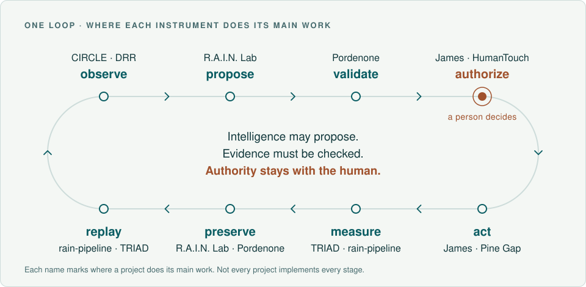

<picture>
  <source media="(prefers-color-scheme: dark)" srcset="assets/nea-onnim-dark.svg">
  <source media="(prefers-color-scheme: light)" srcset="assets/nea-onnim-light.svg">
  
</picture>

# Christopher Woodyard

**I make strange things and test whether they work.**

Researcher · educator · musician · artist · founder of [Vers3Dynamics](https://vers3dynamics.com/), an open-source resonant intelligence lab in the Washington, DC area.

I build instruments for relationships we cannot readily see: between signals and states, models and evidence, an agent's intention and its consequences. The work moves between biosignals, nonlinear dynamics, autonomous scientific investigation, explorable worlds, and sound. Each medium is another way to ask: **What changed? What can we actually know? What happens if we respond?**

> **We build intelligence that thinks beside you, not for you.**

**Built by one researcher. Held in common. Free to explore.**

[**Meet James →**](https://github.com/topherchris420/james) · [**Explore the twin →**](https://lop-nur-twin.vercel.app/) · [**Play Pine Gap →**](https://geotwn.vercel.app/) · [**Try HumanTouch →**](https://huggingface.co/spaces/ciaochris/HumanTouch) · [**Read what failed →**](docs/project-map.md#what-didnt-survive-contact) · [**Hear the music →**](https://chriswoodyard.bandcamp.com/)

[The idea](#the-idea) · [Enter the work](#enter-the-work) · [What the evidence says](#what-the-evidence-says) · [Participate](#participate) · [Full project map](docs/project-map.md)

## The idea

Most AI demos show what a model said. I want to show **what it was allowed to do, what actually happened, and what would change our minds.**

One loop runs through the lab:

```text
observe → propose → validate → authorize → act → measure → preserve → replay
```

<picture>
  <source media="(prefers-color-scheme: dark)" srcset="assets/loop-dark.svg">
  <source media="(prefers-color-scheme: light)" srcset="assets/loop-light.svg">
  
</picture>

*The authorize step is never the model's. It belongs to a person, or to a deterministic policy a person wrote.*

Three boundaries keep the loop honest: a model's inference is not evidence, its confidence is not permission, and a beautiful simulation is not a measurement of the real world.

> **Intelligence may propose. Evidence must be checked. Authority stays with the human.**

## Enter the work

Seven ways in, following the loop from proposal to action to measurement and back. Start wherever you like.

### 01 / R.A.I.N. Lab · Give research a memory

*On the loop: observe → propose → preserve*

**The current R.A.I.N. Lab lives in [Lop Nur Twin](https://github.com/topherchris420/lop-nur-twin).** Its original `james_library` research runtime was integrated into the repository as native TypeScript: the research team, corpus, experiment registry, and evidence mechanisms now operate inside the Bethesda simulation, not as a separately installed Python project. The [migration record](https://github.com/topherchris420/lop-nur-twin/blob/main/docs/RAIN_MIGRATION.md) documents the source revision, parity tests, and what was intentionally left out.

Inside this lab, a local model can observe a simulated world, propose hypotheses, choose among pre-authorized experiments, inspect host-executed results, preserve contradictions, and suggest what to investigate next. The human defines the charter; the host retains control of simulation, evidence, budgets, and stopping rules. [James](https://github.com/topherchris420/james), the lab's desktop companion, can read its results and discuss them with you, but cannot steer it.

[**Explore the world →**](https://lop-nur-twin.vercel.app/) · [**Open the R.A.I.N. source →**](https://github.com/topherchris420/lop-nur-twin) · [**Read the research loop →**](https://github.com/topherchris420/lop-nur-twin#why-this-is-more-than-a-digital-twin) · [**Run the integrated lab locally →**](https://github.com/topherchris420/lop-nur-twin#a-lab-behind-a-door)

The integrated lab's offline meetings and authorized experiments belong to this repository. Its **autonomous research loop** is experimental and runs **locally from the command line**, not on the deployed website, using a configured local model. Historical results from `james_library` remain archival evidence, not proof that the newer autonomous loop makes accurate scientific discoveries.

<a href="https://github.com/topherchris420/lop-nur-twin/blob/f1dfe3f880c071f98836ab46edcce6f92641b613/docs/screenshots/rain-lab-meeting.png"></a>
<a href="https://github.com/topherchris420/lop-nur-twin/blob/f1dfe3f880c071f98836ab46edcce6f92641b613/docs/screenshots/rain-lab-record.png"></a>

*Inside Bethesda, the actual R.A.I.N. research panel. Left: a labelled scripted offline meeting, not an independently evaluated model session. Right: an experiment's record, limitations, provenance and replay. A matching simulator replay establishes computational consistency, not real-world validation.*

<!-- ledger:rain-lab -->

Evidence ladder (historical R.A.I.N. experiments, recorded before the migration): `EXECUTABLE` · `OBSERVED` (seeded quotation checks and simulated controls; same-seed reruns). These labels do not certify the integrated autonomous research runtime; live-model scientific accuracy remains unmeasured.

### 02 / Pordenone · Give agents boundaries

*On the loop: validate → authorize → replay*

Before an agent changes authoritative state, the [Resonate AI Mesh](https://github.com/topherchris420/resonate-ai-mesh) kernel requires deterministic validation, then optional bounded judgment and a policy decision. It records the path so the run can be explained, replayed offline, and compared with a counterfactual. A model can propose; it cannot grant itself authority.

[**Run the offline demo →**](https://github.com/topherchris420/resonate-ai-mesh#one-command) · [**Inspect the execution law →**](https://github.com/topherchris420/resonate-ai-mesh#the-execution-law) · [**Examine recorded experiments →**](https://github.com/topherchris420/resonate-ai-mesh#a-reproducible-experiment)

<a href="https://github.com/topherchris420/resonate-ai-mesh/blob/f90f0f7325163d8ed5e61584437dd5cae992aaef/docs/images/cockpit-replay.png">
  
</a>

*Pordenone's actual research cockpit: simulated human approval cannot override the deterministic freshness check.*

Current controlled experiments use simulated environments, not customer production deployments.

<!-- ledger:pordenone -->

Evidence ladder: `EXECUTABLE` (simulated telemetry; external reliability unestablished).

### 03 / James · Authority stays with you

*On the loop: authorize → act*

Most desktop agents ask for your trust up front and then spend it however they like. [James](https://github.com/topherchris420/james) works the other way round. It talks only to a model running on your own machine, sees your screen only when you capture it, and turns anything that would change your computer into **one exact proposal you approve once**. Then it stops and waits for you to confirm what actually happened.

The boundary is built into the structure, not the prompt. Every request leaves through a small Rust client whose only address input is a port number, so it has no way to name a destination beyond your own machine. An approval covers a single action and expires with a stale capture or a delayed dispatch, and James records its intent on disk before any input is sent. Voice has no path to approving anything.

[**Run James →**](https://github.com/topherchris420/james#quick-start) · [**See how approval works →**](https://github.com/topherchris420/james#how-james-works) · [**Read the validation ledger →**](https://github.com/topherchris420/james/blob/main/docs/VALIDATION.md)

<a href="https://github.com/topherchris420/james/blob/31cdff1822b2026a916cb582d7be97afc7037d2f/docs/assets/james-conversation.png">
  
</a>

*A real James session, not a mockup: Qwen2.5-3B-Instruct served from the same machine, replies unedited. One observed session, not a benchmark of model quality. [How it was captured](https://github.com/topherchris420/james/blob/31cdff1822b2026a916cb582d7be97afc7037d2f/docs/VALIDATION.md#readme-screenshot-session-2026-10-11).*

James is a developer preview. Reviewed input works only on Windows, the builds are unsigned, and real-model quality, usability and clean-machine installation are not yet proven.

<!-- ledger:james -->

Evidence ladder: `EXECUTABLE` (desktop preview; approval contracts tested with simulated actions, not a usability or real-model evaluation).

### 04 / Worlds · When an agent has somewhere to go

*On the loop: act → preserve, inside a simulation*

**Pine Gap: After Hours** is a playable browser world. Deliver coffee, follow a numbers station, find a concert. Take the controls yourself or watch a scripted agent attempt tasks under the same movement and world rules.

[**Play After Hours →**](https://geotwn.vercel.app/) · [**Watch the scripted agent →**](https://geotwn.vercel.app/?controller=mock) · [**Live Jev setup →**](https://github.com/topherchris420/satellite-vision-scape#run-jev-yourself)

The scripted agent needs no key; live Jev requires a TypeSafe key.

<a href="https://geotwn.vercel.app/">
  
</a>

*An actual game capture. My own music plays on the radio.*

<a href="https://github.com/topherchris420/satellite-vision-scape/blob/3457607680492edf4e4c9117859429846695f10c/docs/media/agent-drive.gif">
  
</a>

*Recorded **scripted-agent baseline**, replayed at 10× speed, completing the coffee leg in 87.5 seconds. This is not a live Jev model run. [Watch the smaller MP4](https://github.com/topherchris420/satellite-vision-scape/blob/3457607680492edf4e4c9117859429846695f10c/docs/media/agent-drive.mp4) · [Inspect the game](https://github.com/topherchris420/satellite-vision-scape).*

One [recorded live Jev session](https://github.com/topherchris420/satellite-vision-scape/blob/bff1f8095739d925a9e0bc13e3a6566cf2363d04/docs/traces/jev-after-hours-live-2026-09-27.json) completed the mission in **7m 38s** without human intervention. It is one run, not a measured success rate.

<!-- ledger:pine-gap -->

Evidence ladder: `EXECUTABLE` · `OBSERVED` (one live-agent trace and paired scripted experiments).

**Lop Nur Twin / Blacksite** reconstructs a desert airfield from public sources. Inspect which structures are observed, reported, inferred, or illustrative, and enter a game on the same geometry. A hidden Bethesda world holds the integrated R.A.I.N. Lab. Simulated game events never become evidence about the real site.

[**Inspect the evidence →**](https://lop-nur-twin.vercel.app/analysis) · [**Play Blacksite →**](https://lop-nur-twin.vercel.app/play) · [**Explore the code →**](https://github.com/topherchris420/lop-nur-twin)

<a href="https://github.com/topherchris420/lop-nur-twin/blob/f1dfe3f880c071f98836ab46edcce6f92641b613/docs/screenshots/bethesda-street.png"></a>
<a href="https://github.com/topherchris420/lop-nur-twin/blob/f1dfe3f880c071f98836ab46edcce6f92641b613/docs/screenshot-lens.png"></a>

*Left: Bethesda inside Lop Nur Twin, an explorable simulation rather than live footage or a claim about real residents. Right: the evidence lens, which distinguishes documented reconstruction from interpretation. Its colors describe the provenance of the model, not independent proof of a site's activity.*

<!-- ledger:lop-nur -->

Evidence ladder: `EXECUTABLE` (documented reconstruction and simulation; not confirmation of real-world site activity).

### 05 / TRIAD · Know when not to answer

*On the loop: measure → replay*

[TRIAD](https://github.com/topherchris420/triad) asks when a sensor should refuse to answer, and when any predictive system should recognize that its evidence is insufficient. It began as a simulated capacitive sensor. Milestone by milestone, the question widened to real public datasets, then to the claims people make *about* predictive systems. Each test was frozen in Git before it ran.

So far, the answers to its central questions have been no. A converged optimizer was not a trustworthy one: half of the position errors above 5 mm carried a successful convergence flag. On real data, TRIAD's evidence-qualified decisions cost slightly more than standard monitoring. And in a pre-registered test on 5,078 claims from five public datasets, its evidence rules lost to a blind statistical reviewer **and cost more than endorsing nothing at all.**

Those negative results are the findings. What survives is a lesson the whole lab rests on: a stopping flag, a confidence score and a supplied evidence record are each different from evidence that an answer is right. Every headline number in TRIAD's README is bound to the archived artifact that produced it, and CI fails if the README misquotes one.

[**Read the research arc →**](https://github.com/topherchris420/triad#the-research-arc-machine-checked) · [**Inspect Milestone 8 →**](https://github.com/topherchris420/triad/blob/7be64c8c93f2ef3238ac18b386aa5bb81c214bbb/docs/metrology/milestone8-results.md) · [**Measure selective risk yourself →**](https://github.com/topherchris420/triad/blob/master/docs/metrology/selective-risk-quickstart.md)

<a href="https://github.com/topherchris420/triad/blob/7be64c8c93f2ef3238ac18b386aa5bb81c214bbb/results/milestone7-plots/bike-sharing.png">
  
</a>

*TRIAD's Milestone 7 on UCI Bike Sharing with frozen models. Bottom right is the pre-specified primary effect, TRIAD's cost minus standard monitoring's: every estimate sits above zero, so TRIAD cost slightly more. [Full results](https://github.com/topherchris420/triad/blob/7be64c8c93f2ef3238ac18b386aa5bb81c214bbb/docs/metrology/milestone7-results.md).*

The blind comparators were written by an AI agent of the same model family, working from a brief alone. There has been no human adjudication, unrelated-team replication or peer review.

<!-- ledger:triad -->

Evidence ladder: `EXECUTABLE` · `OBSERVED` (simulated sensor; frozen models on public datasets) · `NOT SUPPORTED` (pre-registered test of its evidence rules against blind comparators).

### 06 / DRR + CIRCLE · Let signals speak, then check the answer

*On the loop: observe, where the next turn begins*

[Dynamic Resonance Rooting](https://github.com/topherchris420/dynamic-resonance-rooting) investigates recurring frequencies, lagged relationships, and structural changes in multivariate time series. Its tests distinguish statistical lead–lag from causation, and a preregistered external test that failed its tolerance remains published.

[**Run the known-signal example →**](https://github.com/topherchris420/dynamic-resonance-rooting#quick-start) · [**Read the external result →**](https://github.com/topherchris420/dynamic-resonance-rooting/blob/main/docs/external-evidence.md)

<a href="https://github.com/topherchris420/dynamic-resonance-rooting/blob/862c4f75e6092e3314eb786adcb9fa2a7ee3e779/docs/assets/drr-flier.png">
  
</a>

*DRR's own research flier. It illustrates the project, not a new validation result.*

<!-- ledger:drr -->

Evidence ladder: `OBSERVED` (synthetic calibration) · `NOT SUPPORTED` (one preregistered external structural-change test).

[CIRCLE](https://github.com/topherchris420/circle) takes a related question into closed-loop biosignal research: can a system preserve the path from raw measurement to bounded decision to independently observed actuation? Its simulated physiology twin records gaps, refusals, and the distinction between issuing a cue and verifying it occurred.

[**Run the physiology twin →**](https://github.com/topherchris420/circle#run-the-digital-test-bench) · [**Inspect the evidence chain →**](https://github.com/topherchris420/circle#closed-loop-evidence)

<a href="https://github.com/topherchris420/circle/blob/774ddf8750dbe03fd207403d1b4bc428816f3967/diagrams/physiology-polygraph.png">
  
</a>

*CIRCLE's simulated physiology traces plotted against known synthetic ground truth. No human signals or fabricated board are represented.*

<a href="https://github.com/topherchris420/circle/blob/774ddf8750dbe03fd207403d1b4bc428816f3967/diagrams/circle-3d-animation.gif">
  
</a>

*CIRCLE Rev B, a rotating **design visualization**, not a physical device or measured telemetry. [Open the hardware design](https://github.com/topherchris420/circle).*

Its boards are designed, not built. There is no human or physical-device validation, and the hardware is **not approved for fabrication or human connection**.

<!-- ledger:circle -->

Evidence ladder: `OBSERVED` (simulated physiology twin) · `BUILDING` (hardware design).

### 07 / HumanTouch · Let the voice remain yours

*On the loop: propose → authorize, with the author as the authority*

Not every intelligent tool needs to speak louder. [HumanTouch](https://huggingface.co/spaces/ciaochris/HumanTouch) is a writing studio that tracks proposed edits and gives the author control over changes to meaning, certainty, numbers, and voice. Its purpose is not generically polished prose; it is retaining the texture of someone's own.

[**Open the writing studio →**](https://huggingface.co/spaces/ciaochris/HumanTouch) · [**Inspect the source →**](https://huggingface.co/spaces/ciaochris/HumanTouch/tree/main)

Its offline measurement tests use synthetic fixtures without a model. They do not yet establish live editing quality.

<!-- ledger:humantouch -->

Evidence ladder: `EXECUTABLE` · `OBSERVED` (offline instrument calibration on synthetic fixtures, not live-model evaluation).

## What the evidence says

The point is not to make every idea look right. It is to build things that can tell me when I am wrong. So far, the most informative results are the ones that said no.

- **TRIAD (pre-registered, real outcomes):** On 5,078 reliability claims about five public datasets, TRIAD's evidence rules had a decision cost of 0.159. A blind statistical reviewer scored 0.121, and endorsing nothing scored 0.125. Under criteria fixed before any case existed, the verdict is **not established**. [Milestone 8](https://github.com/topherchris420/triad/blob/7be64c8c93f2ef3238ac18b386aa5bb81c214bbb/docs/metrology/milestone8-results.md).
- **DRR:** A preregistered external structural-change test exceeded the permitted false-alarm rate. The claim remains **not supported**. [External evidence](https://github.com/topherchris420/dynamic-resonance-rooting/blob/862c4f75e6092e3314eb786adcb9fa2a7ee3e779/docs/external-evidence.md).
- **James:** In the session behind its screenshot, a 1.5B model once claimed that *it* retains authority over its actions, and a 0.5B model called a simulator finding real-world evidence. That is why authority lives in code, not in what a model says about itself. [Validation record](https://github.com/topherchris420/james/blob/31cdff1822b2026a916cb582d7be97afc7037d2f/docs/VALIDATION.md#readme-screenshot-session-2026-10-11).
- **Pine Gap:** Ten paired scripted runs per condition found graded dial turns locked four terminals every time, while long holds locked none. [Experiment and traces](https://github.com/topherchris420/satellite-vision-scape/blob/bff1f8095739d925a9e0bc13e3a6566cf2363d04/experiments/results/tuning-control-magnitude/report.md).
- **R.A.I.N. (historical test, before integration):** The seeded quotation gate rejected fabricated quotes, but also rejected genuine quotes with typography changes. That failure remains visible in the [archived source revision](https://github.com/topherchris420/james_library/blob/9c8811e343d21b8c143055f9cf549abdefa862f1/RESULTS.md); the [current lab](https://github.com/topherchris420/lop-nur-twin) is now maintained elsewhere.
- **Research pipeline:** [rain-pipeline](https://github.com/topherchris420/rain-pipeline) separates exploration, preregistration, held-out real data, deterministic evaluation, and replay. Its experiments include a failed hypothesis. Project-specific verdicts are not automatic promotions on this profile's evidence ladder.

<a href="https://github.com/topherchris420/rain-pipeline/blob/d85ec37f80e7f1df7c9b8d77ecbb74e37b27630b/runs/20261004T181106Z/figure.png">
  
</a>

*Real-data analysis from experiment V3D-EXP-0003. All three lag-window choices reached a detection ceiling on the same held-out windows, so this plot does **not** show that the adaptive approach improves detection. [Read the full run](https://github.com/topherchris420/rain-pipeline/blob/d85ec37f80e7f1df7c9b8d77ecbb74e37b27630b/runs/20261004T181106Z/REPORT.md).*

The [public ledger](experiments/README.md) uses `CONCEIVED` → `BUILDING` → `EXECUTABLE` → `OBSERVED` → `REPRODUCED` → `SUPPORTED`, with `NOT SUPPORTED` for claims that fail preregistered tests. A result on a simulated system is not a result on a person, and a repetition by the same hands is not an independent one.

**Nothing here has reached `REPRODUCED` or `SUPPORTED` yet.**

*Reviewed 12 October 2026. James and TRIAD were added from their public repositories; other entries keep the review dates recorded in the ledger. The linked experimental evidence is a dated snapshot. Newer implementation descriptions do not automatically become new evidence claims.*

[**Evidence ledger →**](experiments/README.md) · [**Machine-readable states →**](experiments/ledger.json) · [**Full project map and discarded approaches →**](docs/project-map.md) · [**How this page checks itself →**](docs/profile-maintenance.md)

## One practice, many forms

My music, paintings, poetry, and research are not separate identities. They are different instruments for noticing. I record as **Indigo People**; my [Vanta portfolio](https://mitpress.vercel.app/) holds the wider practice, and [Vers3Dynamics Studio](https://github.com/topherchris420/quantum-spin-sound) explores live-coded sound and audio-reactive visuals.

[**Listen →**](https://chriswoodyard.bandcamp.com/) · [**See the art and writing →**](https://mitpress.vercel.app/) · [**Browse the research atlas →**](https://mitpress.vercel.app/research)

<a href="https://github.com/topherchris420/vanta/blob/120c6c4d36356fc7a7b5ffa3fc8729d1ecc0b069/public/work/impasto-head.webp">
  
</a>

*An original artwork from Vanta. The paintings, music, research instruments and simulated worlds belong to one practice.*

*What emerges between them belongs to everyone.*

## Participate

You do not need to understand every paper or install every model. Start with something you can actually inspect.

- **Curious?** [Walk the twin](https://lop-nur-twin.vercel.app/), [play Pine Gap](https://geotwn.vercel.app/), or [try HumanTouch](https://huggingface.co/spaces/ciaochris/HumanTouch).
- **Running a local model?** [Install James](https://github.com/topherchris420/james#quick-start), ask it about your screen, and see whether anything gets past its review. If something does, [report it](https://github.com/topherchris420/james/blob/main/SECURITY.md).
- **Building agents?** [Run the Pordenone demo](https://github.com/topherchris420/resonate-ai-mesh#one-command), inject a fault, and inspect the recorded outcome.
- **Doing research?** [Replay an experiment](https://github.com/topherchris420/rain-pipeline), [challenge a DRR result](https://github.com/topherchris420/dynamic-resonance-rooting), or [criticize TRIAD's comparators](https://github.com/topherchris420/triad/issues/new?template=scientific-criticism.md). Independent reproduction is the rung I cannot climb alone.
- **Want to collaborate?** Open an issue on the relevant repository or [write to me](mailto:christopher@vers3dynamics.com). To help keep the work available without a paywall, [support the lab](https://ko-fi.com/vers3dynamics).

## How I work

My method: **maximum conceptual ambition; minimum credible experiment.** Build something, decide what would falsify it, keep what happened, and build again.

**The 72-hour question.** *If a meaningful version had to exist within 72 hours, what would we actually need to build?* It is not a deadline. It forces a large idea to collapse into a small experiment, and "this needs six months" is still an answer. AI now makes the building fast, and sometimes the first answer too: TRIAD reached a pre-registered negative result on the same calendar day as its first commit. What AI cannot speed up is independence. TRIAD's comparators were written by an AI, and no person has adjudicated the result. [How long each step took →](experiments/unreasonably-fast.md)

**Resonance as Substrate. Intelligence as a Layer.**

---

> I create because the alternative is unbearable: a day that occurs and is not noticed occurring.
