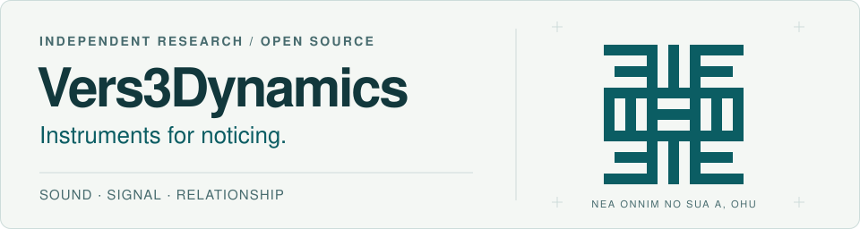

<picture>
  <source media="(prefers-color-scheme: dark)" srcset="assets/nea-onnim-dark.svg">
  <source media="(prefers-color-scheme: light)" srcset="assets/nea-onnim-light.svg">
  
</picture>

# Christopher Woodyard

**I make strange things and test whether they work.**

Researcher · educator · musician · artist · founder of [Vers3Dynamics](https://vers3dynamics.com/), an open-source resonant intelligence lab in the Washington, DC area.

I build instruments for relationships we cannot readily see: between signals and states, models and evidence, an agent's intention and its consequences. The work moves between biosignals, nonlinear dynamics, autonomous scientific investigation, explorable worlds, and sound. Each medium is another way to ask: **What changed? What can we actually know? What happens if we respond?**

> **We build intelligence that thinks beside you, not for you.**

**Built by one researcher. Held in common. Free to explore.**

[**R.A.I.N. Lab source →**](https://github.com/topherchris420/lop-nur-twin) · [**Explore the twin →**](https://lop-nur-twin.vercel.app/) · [**Play Pine Gap →**](https://geotwn.vercel.app/) · [**Try HumanTouch →**](https://huggingface.co/spaces/ciaochris/HumanTouch) · [**Hear the music →**](https://chriswoodyard.bandcamp.com/)

[The idea](#the-idea) · [Enter the work](#enter-the-work) · [What the evidence says](#what-the-evidence-says) · [Participate](#participate) · [Full project map](docs/project-map.md)

## The idea

Most AI demos show what a model said. I want to show **what it was allowed to do, what actually happened, and what would change our minds.**

A recurring design principle runs through the lab:

```text
observe → propose → validate → authorize → act → measure → preserve → replay
```

Not every project implements every stage. What connects them is the boundary: a model's inference is not evidence, its confidence is not permission, and a beautiful simulation is not a measurement of the real world.

**Resonance as Substrate. Intelligence as a Layer.**

## Enter the work

### 01 / R.A.I.N. Lab · Give research a memory

**The current R.A.I.N. Lab lives in [Lop Nur Twin](https://github.com/topherchris420/lop-nur-twin).** Its original `james_library` research runtime was integrated into the repository as native TypeScript: the research team, corpus, experiment registry, and evidence mechanisms now operate inside the Bethesda simulation, not as a separately installed Python project. The [migration record](https://github.com/topherchris420/lop-nur-twin/blob/main/docs/RAIN_MIGRATION.md) documents the source revision, parity tests, and what was intentionally left out.

Inside this lab, a local model can observe a simulated world, propose hypotheses, choose among pre-authorized experiments, inspect host-executed results, preserve contradictions, and suggest what to investigate next. The human defines the charter; the host retains control of simulation, evidence, budgets, and stopping rules.

[**Explore the world →**](https://lop-nur-twin.vercel.app/) · [**Open the R.A.I.N. source →**](https://github.com/topherchris420/lop-nur-twin) · [**Read the research loop →**](https://github.com/topherchris420/lop-nur-twin#why-this-is-more-than-a-digital-twin) · [**Run the integrated lab locally →**](https://github.com/topherchris420/lop-nur-twin#a-lab-behind-a-door)

The integrated lab's offline meetings and authorized experiments belong to this repository. Its **autonomous research loop** is experimental and runs **locally from the command line**, not on the deployed website, using a configured local model. Historical results from `james_library` remain archival evidence, not proof that the newer autonomous loop makes accurate scientific discoveries.


<a href="https://github.com/topherchris420/lop-nur-twin/blob/f1dfe3f880c071f98836ab46edcce6f92641b613/docs/screenshots/rain-lab-meeting.png">
  
</a>

*Inside Bethesda: the actual R.A.I.N. research panel. This capture shows a labelled scripted offline meeting, not an independently evaluated model session.*


<a href="https://github.com/topherchris420/lop-nur-twin/blob/f1dfe3f880c071f98836ab46edcce6f92641b613/docs/screenshots/rain-lab-record.png">
  
</a>

*An experiment's record, limitations, provenance and replay. A matching simulator replay establishes computational consistency, not real-world validation.*


<!-- ledger:rain-lab -->

Evidence ladder (historical R.A.I.N. experiments, recorded before the migration): `EXECUTABLE` · `OBSERVED` (seeded quotation checks and simulated controls; same-seed reruns). These labels do not certify the integrated autonomous research runtime; live-model scientific accuracy remains unmeasured.

### 02 / Pordenone · Give agents boundaries

Before an agent changes authoritative state, the [Resonate AI Mesh](https://github.com/topherchris420/resonate-ai-mesh) kernel requires deterministic validation, then optional bounded judgment and a policy decision. It records the path so the run can be explained, replayed offline, and compared with a counterfactual. A model can propose; it cannot grant itself authority.

[**Run the offline demo →**](https://github.com/topherchris420/resonate-ai-mesh#one-command) · [**Inspect the execution law →**](https://github.com/topherchris420/resonate-ai-mesh#the-execution-law) · [**Examine recorded experiments →**](https://github.com/topherchris420/resonate-ai-mesh#a-reproducible-experiment)

<a href="https://github.com/topherchris420/resonate-ai-mesh/blob/f90f0f7325163d8ed5e61584437dd5cae992aaef/docs/images/cockpit-replay.png">
  
</a>

*Pordenone's actual research cockpit: simulated human approval cannot override the deterministic freshness check.*

Current controlled experiments use simulated environments, not customer production deployments.

<!-- ledger:pordenone -->

Evidence ladder: `EXECUTABLE` (simulated telemetry; external reliability unestablished).

### 03 / DRR + CIRCLE · Let signals speak, then check the answer

[Dynamic Resonance Rooting](https://github.com/topherchris420/dynamic-resonance-rooting) investigates recurring frequencies, lagged relationships, and structural changes in multivariate time series. Its tests distinguish statistical lead–lag from causation, and a preregistered external test that failed its tolerance remains published.

[**Run the known-signal example →**](https://github.com/topherchris420/dynamic-resonance-rooting#quick-start) · [**Read the external result →**](https://github.com/topherchris420/dynamic-resonance-rooting/blob/main/docs/external-evidence.md)

<a href="https://github.com/topherchris420/dynamic-resonance-rooting/blob/862c4f75e6092e3314eb786adcb9fa2a7ee3e779/docs/assets/drr-flier.png">
  
</a>

*DRR's own research flier. It illustrates the project, not a new validation result.*

<!-- ledger:drr -->

Evidence ladder: `OBSERVED` (synthetic calibration) · `NOT SUPPORTED` (one preregistered external structural-change test).

[CIRCLE](https://github.com/topherchris420/circle) takes a related question into closed-loop biosignal research: can a system preserve the path from raw measurement to bounded decision to independently observed actuation? Its simulated physiology twin records gaps, refusals, and the distinction between issuing a cue and verifying it occurred.

[**Run the physiology twin →**](https://github.com/topherchris420/circle#run-the-digital-test-bench) · [**Inspect the evidence chain →**](https://github.com/topherchris420/circle#closed-loop-evidence)

<a href="https://github.com/topherchris420/circle/blob/774ddf8750dbe03fd207403d1b4bc428816f3967/diagrams/physiology-polygraph.png">
  
</a>

*CIRCLE's simulated physiology traces plotted against known synthetic ground truth. No human signals or fabricated board are represented.*

<a href="https://github.com/topherchris420/circle/blob/774ddf8750dbe03fd207403d1b4bc428816f3967/diagrams/circle-3d-animation.gif">
  
</a>

*CIRCLE Rev B, a rotating **design visualization**, not a physical device or measured telemetry. [Open the hardware design](https://github.com/topherchris420/circle).*

Its boards are designed, not built. There is no human or physical-device validation, and the hardware is **not approved for fabrication or human connection**.

<!-- ledger:circle -->

Evidence ladder: `OBSERVED` (simulated physiology twin) · `BUILDING` (hardware design).

### 04 / Worlds · When an agent has somewhere to go

**Pine Gap: After Hours** is a playable browser world. Deliver coffee, follow a numbers station, find a concert. Take the controls yourself or watch a scripted agent attempt tasks under the same movement and world rules.

[**Play After Hours →**](https://geotwn.vercel.app/) · [**Watch the scripted agent →**](https://geotwn.vercel.app/?controller=mock) · [**Live Jev setup →**](https://github.com/topherchris420/satellite-vision-scape#run-jev-yourself)

The scripted agent needs no key; live Jev requires a TypeSafe key.

<a href="https://geotwn.vercel.app/">
  
</a>

*An actual game capture. My own music plays on the radio.*

<a href="https://github.com/topherchris420/satellite-vision-scape/blob/3457607680492edf4e4c9117859429846695f10c/docs/media/agent-drive.gif">
  
</a>

*Recorded **scripted-agent baseline**, replayed at 10× speed, completing the coffee leg in 87.5 seconds. This is not a live Jev model run. [Watch the smaller MP4](https://github.com/topherchris420/satellite-vision-scape/blob/3457607680492edf4e4c9117859429846695f10c/docs/media/agent-drive.mp4) · [Inspect the game](https://github.com/topherchris420/satellite-vision-scape).*

One [recorded live Jev session](https://github.com/topherchris420/satellite-vision-scape/blob/bff1f8095739d925a9e0bc13e3a6566cf2363d04/docs/traces/jev-after-hours-live-2026-09-27.json) completed the mission in **7m 38s** without human intervention. It is one run, not a measured success rate.

<!-- ledger:pine-gap -->

Evidence ladder: `EXECUTABLE` · `OBSERVED` (one live-agent trace and paired scripted experiments).

**Lop Nur Twin / Blacksite** reconstructs a desert airfield from public sources. Inspect which structures are observed, reported, inferred, or illustrative, and enter a game on the same geometry. A hidden Bethesda world holds the integrated R.A.I.N. Lab. Simulated game events never become evidence about the real site.


<a href="https://github.com/topherchris420/lop-nur-twin/blob/f1dfe3f880c071f98836ab46edcce6f92641b613/docs/screenshots/bethesda-street.png">
  
</a>

*Bethesda inside Lop Nur Twin, an explorable simulation rather than live footage or a claim about real residents.*


<a href="https://github.com/topherchris420/lop-nur-twin/blob/f1dfe3f880c071f98836ab46edcce6f92641b613/docs/screenshot-lens.png">
  
</a>

*The evidence lens distinguishes documented reconstruction from interpretation. Its colors describe the provenance of the model, not independent proof of a site's activity.*


[**Inspect the evidence →**](https://lop-nur-twin.vercel.app/analysis) · [**Play Blacksite →**](https://lop-nur-twin.vercel.app/play) · [**Explore the code →**](https://github.com/topherchris420/lop-nur-twin)

<!-- ledger:lop-nur -->

Evidence ladder: `EXECUTABLE` (documented reconstruction and simulation; not confirmation of real-world site activity).

### 05 / HumanTouch · Let the voice remain yours

Not every intelligent tool needs to speak louder. [HumanTouch](https://huggingface.co/spaces/ciaochris/HumanTouch) is a writing studio that tracks proposed edits and gives the author control over changes to meaning, certainty, numbers, and voice. Its purpose is not generically polished prose; it is retaining the texture of someone's own.

[**Open the writing studio →**](https://huggingface.co/spaces/ciaochris/HumanTouch) · [**Inspect the source →**](https://huggingface.co/spaces/ciaochris/HumanTouch/tree/main)

Its offline measurement tests use synthetic fixtures without a model. They do not yet establish live editing quality.

<!-- ledger:humantouch -->

Evidence ladder: `EXECUTABLE` · `OBSERVED` (offline instrument calibration on synthetic fixtures, not live-model evaluation).

## What the evidence says

The point is not to make every idea look right. It is to build things that can tell me when I am wrong.

- **Pine Gap:** Ten paired scripted runs per condition found graded dial turns locked four terminals every time, while long holds locked none. [Experiment and traces](https://github.com/topherchris420/satellite-vision-scape/blob/bff1f8095739d925a9e0bc13e3a6566cf2363d04/experiments/results/tuning-control-magnitude/report.md).
- **R.A.I.N. (historical test, before integration):** The seeded quotation gate rejected fabricated quotes, but also rejected genuine quotes with typography changes. That failure remains visible in the [archived source revision](https://github.com/topherchris420/james_library/blob/9c8811e343d21b8c143055f9cf549abdefa862f1/RESULTS.md); the [current lab](https://github.com/topherchris420/lop-nur-twin) is now maintained elsewhere.
- **DRR:** A preregistered external structural-change test exceeded the permitted false-alarm rate. The claim remains **not supported**. [External evidence](https://github.com/topherchris420/dynamic-resonance-rooting/blob/862c4f75e6092e3314eb786adcb9fa2a7ee3e779/docs/external-evidence.md).
- **Research pipeline:** [rain-pipeline](https://github.com/topherchris420/rain-pipeline) separates exploration, preregistration, held-out real data, deterministic evaluation, and replay. Its experiments include a failed hypothesis. Project-specific verdicts are not automatic promotions on this profile's evidence ladder.

<a href="https://github.com/topherchris420/rain-pipeline/blob/d85ec37f80e7f1df7c9b8d77ecbb74e37b27630b/runs/20261004T181106Z/figure.png">
  
</a>

*Real-data analysis from experiment V3D-EXP-0003. All three lag-window choices reached a detection ceiling on the same held-out windows, so this plot does **not** show that the adaptive approach improves detection. [Read the full run](https://github.com/topherchris420/rain-pipeline/blob/d85ec37f80e7f1df7c9b8d77ecbb74e37b27630b/runs/20261004T181106Z/REPORT.md).*

The [public ledger](experiments/README.md) uses `CONCEIVED` → `BUILDING` → `EXECUTABLE` → `OBSERVED` → `REPRODUCED` → `SUPPORTED`, with `NOT SUPPORTED` for claims that fail preregistered tests. A result on a simulated system is not a result on a person.

**Nothing here has reached `REPRODUCED` or `SUPPORTED` yet.**

*Reviewed 4 October 2026. The linked experimental evidence is a dated snapshot. Newer implementation descriptions do not automatically become new evidence claims.*

[**Evidence ledger →**](experiments/README.md) · [**Machine-readable states →**](experiments/ledger.json) · [**Full project map and discarded approaches →**](docs/project-map.md) · [**How this page checks itself →**](docs/profile-maintenance.md)

## One practice, many forms

My music, paintings, poetry, and research are not separate identities. They are different instruments for noticing. I record as **Indigo People**; my [Vanta portfolio](https://mitpress.vercel.app/) holds the wider practice, and [Vers3Dynamics Studio](https://github.com/topherchris420/quantum-spin-sound) explores live-coded sound and audio-reactive visuals.

[**Listen →**](https://chriswoodyard.bandcamp.com/) · [**See the art and writing →**](https://mitpress.vercel.app/) · [**Browse the research atlas →**](https://mitpress.vercel.app/research)

<a href="https://github.com/topherchris420/vanta/blob/120c6c4d36356fc7a7b5ffa3fc8729d1ecc0b069/public/work/impasto-head.webp">
  
</a>

*An original artwork from Vanta. The paintings, music, research instruments and simulated worlds belong to one practice.*

*What emerges between them belongs to everyone.*

## Participate

You do not need to understand every paper or install every model. Start with something you can actually inspect.

- **Curious?** [Walk the twin](https://lop-nur-twin.vercel.app/), [play Pine Gap](https://geotwn.vercel.app/), or [try HumanTouch](https://huggingface.co/spaces/ciaochris/HumanTouch).
- **Building agents?** [Run the Pordenone demo](https://github.com/topherchris420/resonate-ai-mesh#one-command), inject a fault, and inspect the recorded outcome.
- **Doing research?** [Replay an experiment](https://github.com/topherchris420/rain-pipeline) or [challenge a DRR result](https://github.com/topherchris420/dynamic-resonance-rooting). Independent reproduction is the rung I cannot climb alone.
- **Want to collaborate?** Open an issue on the relevant repository or [write to me](mailto:christopher@vers3dynamics.com). To help keep the work available without a paywall, [support the lab](https://ko-fi.com/vers3dynamics).

## How I work

My method: **maximum conceptual ambition; minimum credible experiment.** Build something, decide what would falsify it, keep what happened, and build again.

---

> I create because the alternative is unbearable: a day that occurs and is not noticed occurring.
