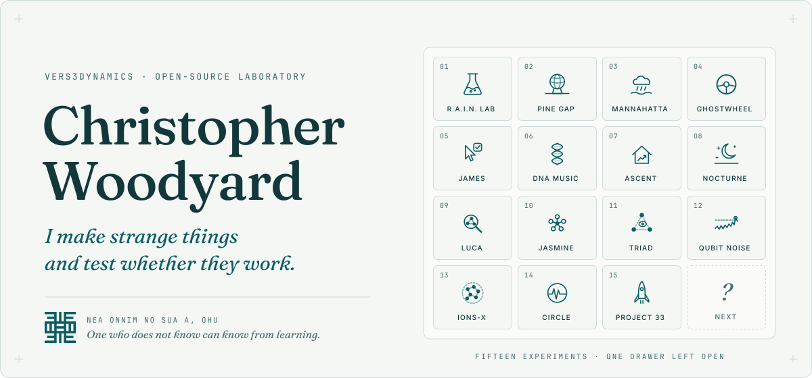
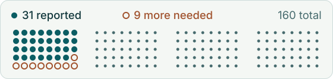
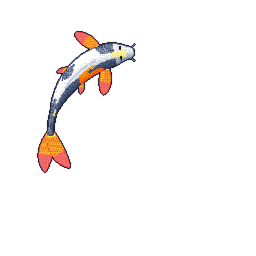

<a href="#start-here"><picture>
<source media="(max-width: 600px) and (prefers-color-scheme: dark)" srcset="assets/hero-mobile-dark.svg">
<source media="(max-width: 600px)" srcset="assets/hero-mobile-light.svg">
<source media="(prefers-color-scheme: dark)" srcset="assets/hero-dark.svg">
<source media="(prefers-color-scheme: light)" srcset="assets/hero-light.svg">

</picture></a>

# The question behind the lab

**What can the physical universe teach us about the extraordinary fact that experience exists at all?**

I don't know. I've come at that question through music, painting, and poetry for much of my life.

I'm Christopher Woodyard, an artist and educator in Washington, DC. I record as Indigo People and build instruments and simulated worlds at my one-person, open-source research lab, [Vers3Dynamics](https://vers3dynamics.com/).

**[Walk into my studio](https://mitpress.vercel.app/studio)** · **[Observe ECHO](https://lop-nur-twin.vercel.app/live)** · **[Judge an experiment](#what-the-evidence-says)** · [Read the full founder's note](docs/the-question-behind-the-lab.md)

## Start here

### From a record to a car radio

I recorded *Green Machine* as **Indigo People** and put the album on the radio in **Pine Gap: After Hours**. Choose **More ways to play → After Hours**, pick up a coffee at the canteen, and take it for a drive. On a keyboard, `R` turns the radio on.

<a href="https://geotwn.vercel.app/"><picture>
<source media="(max-width: 600px), (prefers-reduced-motion: reduce)" srcset="https://raw.githubusercontent.com/topherchris420/vanta/7c710012003edba67b9cf702d80c0a9d14d92b07/public/work/pine-gap-agent-run.webp">

</picture></a>

The silent clip shows a scripted driver at 10× speed in a fictional world. Small screens and reduced-motion settings get a still. <a href="https://github.com/topherchris420/satellite-vision-scape/blob/3457607680492edf4e4c9117859429846695f10c/docs/media/agent-drive.mp4">Watch the recording (MP4)</a>.

**[Hear 14 seconds of Green Machine (MP3)](https://mitpress.vercel.app/work/green-machine-excerpt.mp3)** · [Play the album](https://chriswoodyard.bandcamp.com/album/green-machine) · [Drive Pine Gap](https://geotwn.vercel.app/) · [Inspect the recorded runs](docs/exhibition.md#pine-gap-after-hours)

### Two flies, two histories

Close the browser and ECHO's world keeps going. Open it again and you can see what the simulated fly has been doing in Bethesda. Eva lives in a separate garden with her own clock and memories. Both pages let you watch without starting either fly over.

ECHO in Bethesda and Eva in the garden, recorded on 10 November 2026. The checkpoints let another machine check continuity over a recorded interval.

**[Watch ECHO](https://lop-nur-twin.vercel.app/live)** · [Visit Eva's garden](https://150-136-49-49.sslip.io/) · [Inspect the continuity records](https://github.com/topherchris420/lop-nur-twin#03-a-machine-must-be-able-to-verify-the-history)

### Hear a heartbeat become an instrument

In **CIRCLE**, play a recorded simulation, switch on the sound, and follow a change in the pulse trace through to the audio you hear. The workbench lets you inspect the decision behind each response. A separate study compares recordings from real phone cameras with an ECG reference.

**[Play the CIRCLE workbench](https://topherchris420.github.io/circle/workbench.html)** · [Explore the phone-camera recordings](https://topherchris420.github.io/circle/first-light.html) · [Source](https://github.com/topherchris420/circle)

## What the evidence says

### Would you pass this experiment?

In the first simulated **R.A.I.N. Lab × CIRCLE × TRIAD** study, the system could withhold a reading when the signal was poor. Across four conditions it accepted **297 readings**. Every one was within **3 beats per minute** of the simulated reference.

There was a second condition. The system had to report a reading in **at least one quarter** of the heavy-motion windows. It reported in **31 of 160**. Would you count that as a success?

<picture>
<source media="(prefers-color-scheme: dark)" srcset="assets/motion-coverage-dark.svg">

</picture>

<strong>Open the recorded verdict</strong>

**Inconclusive.** The monitor needed 40 readings under heavy motion. It fell nine short. Knowing the pulse when it spoke answered only half the question. The other half was how often it could give a reading at all.

A follow-up tested different rules on two simulated pulse generators. Two rules cleared the later screen. The original verdict stays on the record.

[Inspect the original counts and registration](https://github.com/topherchris420/lop-nur-twin/blob/de43db4f82d7dc677ad9897b394670c6eeda810d/experiments/crosslab/history/prior-studies.json) · [Read the follow-up and its limits](https://github.com/topherchris420/lop-nur-twin/blob/de43db4f82d7dc677ad9897b394670c6eeda810d/experiments/crosslab/replication/README.md)

Which findings in the wider lab have external support?

<!-- ledger:top-rung -->
**`SUPPORTED`, so far:** Project Ascent's DC house model met its nine preregistered criteria on held-out sales. Quantum Noise Profiler detected no within-sweep drift on one IBM device over two hours.

**`REPRODUCED`, so far:** nothing in the ledger meets its independent-reproduction definition.

*Reviewed 10 November 2026. The partial review covered ATLAS and Lop Nur Twin. The two supported results retain their 21 October review.*

[Read the evidence definitions and all recorded outcomes](experiments/README.md)

## Featured research

Three places to begin if you want to **use a system, inspect the evidence, and see what remains unresolved**. A working demonstration is not the same as a supported scientific claim.

### 01 / Computational life — [Lop Nur Twin](https://github.com/topherchris420/lop-nur-twin)

**Question:** Can a simulated individual keep a verifiable history while its world, controller, and environment change?

**Enter:** [Observe ECHO live](https://lop-nur-twin.vercel.app/live) · [Visit Eva's separate garden](https://150-136-49-49.sslip.io/) · [Explore the larger world](https://lop-nur-twin.vercel.app/)

**Inspect:** [Continuity, experiments and negative findings](https://github.com/topherchris420/lop-nur-twin/blob/main/docs/RESEARCH_CLAIMS.md)

**Not yet established:** Biological equivalence, consciousness, or consistent survival benefits from new learning mechanisms. The connectome experiments are separate from the original Eva and ECHO.

### 02 / Scientific judgment — [R.A.I.N. ATLAS](https://github.com/topherchris420/rain-atlas) + [TRIAD](https://github.com/topherchris420/triad)

**Question:** Can a research system design useful tests, identify a mistaken assumption, and know when to withhold a conclusion?

**Enter:** [Explore R.A.I.N.'s recorded investigations](https://lop-nur-twin.vercel.app/research-intelligence/) · [Inspect TRIAD's research arc](https://github.com/topherchris420/triad#the-research-arc-machine-checked)

**Inspect:** [A failed forecast and unsuccessful revision](https://github.com/topherchris420/lop-nur-twin/blob/main/experiments/crosslab/assumptions/README.md) · [Research evidence ledger](experiments/README.md)

**Not yet established:** That collaborating AI agents reliably outperform a strong single-agent or deterministic research baseline, or that synthetic evaluation results transfer to real-world scientific discovery.

### 03 / Human-centered sensing — [CIRCLE](https://github.com/topherchris420/circle)

**Question:** Can physiological signals become responsive sound and visuals without losing the measurement, timing, and consent decisions behind each change?

**Enter:** [Try the resonance workbench](https://topherchris420.github.io/circle/workbench.html) · [Explore phone-camera recordings](https://topherchris420.github.io/circle/first-light.html)

**Inspect:** [Source and reproducibility materials](https://github.com/topherchris420/circle) · [The inconclusive CIRCLE × TRIAD result](https://github.com/topherchris420/lop-nur-twin/blob/main/experiments/crosslab/replication/README.md)

**Not yet established:** A validated clinical benefit or reliable end-to-end behavior across real physical devices and participants. Simulation results and recorded-device measurements are kept distinct.

[**See all 30 current projects and their maturity labels**](docs/atlas.md) · [**Read the evidence ladder**](experiments/README.md)

## How I work

**R.A.I.N. Lab** is the AI research system I work with at Vers3Dynamics. I choose the questions and set the criteria a claim has to meet. R.A.I.N. can propose a test, write software, and examine what happened. I want to know whether one researcher working this way can choose better experiments. You can follow a proposal all the way to a result the lab had to reject. [Read the failed forecast](https://github.com/topherchris420/lop-nur-twin/blob/de43db4f82d7dc677ad9897b394670c6eeda810d/experiments/crosslab/assumptions/README.md) · [See the build timelines](experiments/unreasonably-fast.md)

### Research divisions

| Division | A place to begin |
| --- | --- |
| [Autonomous Science](docs/divisions.md#division-i--autonomous-science) | Run a bounded investigation with [R.A.I.N. ATLAS](https://github.com/topherchris420/rain-atlas#autonomous-research) or inspect how [TRIAD](https://github.com/topherchris420/triad) scores decisions to withhold a prediction. |
| [Computational Life & Cognition](docs/divisions.md#division-ii--computational-life--cognition) | Follow a fly through a checkpoint in [Lop Nur Twin](https://github.com/topherchris420/lop-nur-twin). |
| [Human-Centered Intelligence](docs/divisions.md#division-iii--human-centered-intelligence) | Trace a change in sound to the signal and consent decision that allowed it in [CIRCLE](https://github.com/topherchris420/circle). |

### Research Observatory

Follow a claim back to its source, find a failed comparison, or pick a next experiment. The downloadable Observatory opens in your browser and compares up to three projects offline.

**[Read the research index](docs/research.md)** · [Download the offline Observatory](https://raw.githubusercontent.com/topherchris420/topherchris420/main/docs/observatory.html) · [Read the ledger](experiments/README.md)

## Choose a door

Two more things you can open in a browser are a fictional car that records why it refused a command and a DC home estimate you can trace back to individual sales. [Drive GHOSTWHEEL](https://ghostwheel-one.vercel.app/) · [Try a sample home in Ascent](https://project-ascent-theta.vercel.app/demo)

<!-- atlas:begin -->
<!-- Generated by tools/build_atlas.py from docs/atlas.json. -->

| Explore | Inside |
| --- | --- |
| **[Play a world](docs/exhibition.md#play-a-world)** | Explore virtual cities, simulations and autonomous agents. |
| **[Challenge an intelligent system](docs/exhibition.md#challenge-an-intelligent-system)** | Investigate decisions, authorization, uncertainty and security. |
| **[Hear the invisible](docs/exhibition.md#hear-the-invisible)** | Discover sound, molecular representations, frequency and resonance. |
| **[Explore a research lab](docs/exhibition.md#explore-a-research-lab)** | Inspect experiments, models, measurements and scientific results. |
| **[Use something practical](docs/exhibition.md#use-something-practical)** | Approachable software for homeowners, creators, device owners and researchers. |
| **[Discover the unusual](docs/exhibition.md#discover-the-unusual)** | Experimental inventions that resist easy categorization. |
| **[The artist's collection](docs/exhibition.md#one-practice-many-forms)** | Music, painting, writing and the portfolio that holds them. |

[**Browse the complete atlas →**](docs/atlas.md) · 30 current projects · 8 archived experiments and forks
<!-- atlas:end -->

## Join in

Bring me a result you couldn't reproduce, a comparison I overlooked, or a question you would try in your own classroom or studio. For a reproduction, include the revision, inputs, and what you saw. [Contribution guide](CONTRIBUTING.md) · [Write to me](mailto:christopher@vers3dynamics.com) · [Support the lab](https://ko-fi.com/vers3dynamics)

See the koi drawn from my GitHub activity

Its markings change when the daily workflow runs. [About git-koi](https://github.com/yalongwastaken/git-koi)

> I create because the alternative is unbearable: a day that occurs and is not noticed occurring.
