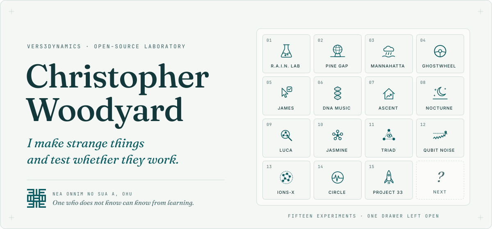
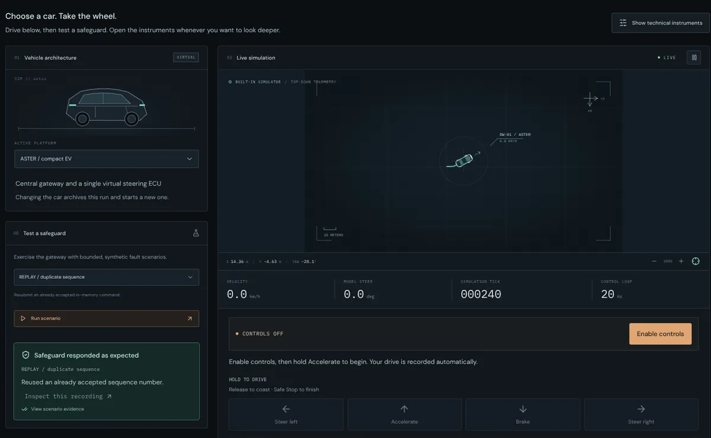

<a href="#start-here"><picture>
<source media="(max-width: 600px) and (prefers-color-scheme: dark)" srcset="assets/hero-mobile-dark.svg">
<source media="(max-width: 600px)" srcset="assets/hero-mobile-light.svg">
<source media="(prefers-color-scheme: dark)" srcset="assets/hero-dark.svg">
<source media="(prefers-color-scheme: light)" srcset="assets/hero-light.svg">

</picture></a>

# Experiments you can open. Evidence you can inspect.

I'm **Christopher Woodyard**, founder of **[Vers3Dynamics](https://vers3dynamics.com/)**, an independent research lab near Washington, DC. I build simulated worlds, research instruments, and practical tools around one question: **what would make an intelligent system's decisions worth trusting?**

I'm also an educator, artist, musician, and writer. Sound, feedback, and experimentation connect the work. The software gives those ideas something to answer to.

**[Try a project](#start-here)** · **[Find your field](#choose-a-door)** · **[Inspect the evidence](#what-the-evidence-says)** · **[Collaborate](#join-in)**

## Start here

Four ways to meet the lab. Each begins with something you can explore in your browser.

### Take a midnight drive with my music

**Pine Gap: After Hours** is a fictional night shift in a world you can drive through. Deliver a coffee, explore the site, and tune in to my original music as **Indigo People** on the vehicle's radio.

The scripted baseline, shown at 10× speed; no AI model ran in this recording. The GIF is silent; open the playable world for the radio. Public-source reconstruction, fictional gameplay.

**[Drive and hear the radio →](https://geotwn.vercel.app/)** · [Listen to Indigo People](https://chriswoodyard.bandcamp.com/) · [Source](https://github.com/topherchris420/satellite-vision-scape) · [Experiment and recorded runs](docs/exhibition.md#pine-gap-after-hours)

### Make a car refuse a command

**GHOSTWHEEL** is an interactive automotive cybersecurity lab. Drive a fictional electric vehicle, introduce a synthetic fault, and follow the gateway's decision into its event record.

Actual browser capture, 21 October 2026. Fictional vehicle and synthetic commands; this browser experience is a simulation.

**[Launch GHOSTWHEEL →](https://ghostwheel-one.vercel.app/)** · [Source](https://github.com/topherchris420/ghostwheel) · [Recorded scope](docs/exhibition.md#ghostwheel)

### Enter a research lab inside a simulated city

**R.A.I.N. Lab / Lop Nur Twin** brings a walkable Bethesda, four AI research perspectives, and inspectable experiment records into one environment. Explore the twin and its evidence; live model research requires a configured local workbench.

**[Explore the twin →](https://lop-nur-twin.vercel.app/)** · [Find Bethesda](https://github.com/topherchris420/lop-nur-twin#explore) · [Source](https://github.com/topherchris420/lop-nur-twin)

### Understand the evidence behind a home estimate

**Project Ascent** helps homeowners examine recorded sales, compare assumptions, and keep the reasoning behind a decision. Start with a fictional home, then explore the covered DC and Maryland markets. Estimates are bounded by their data and published accuracy studies; they are not appraisals.

**[Try the example →](https://project-ascent-theta.vercel.app/demo)** · [Published accuracy](https://project-ascent-theta.vercel.app/accuracy) · [Source](https://github.com/topherchris420/project-ascent)

## Choose a door

Follow your curiosity. The illustrated exhibition keeps the demonstrations, research notes, and source links together; the atlas lists the wider collection.

<!-- atlas:begin -->
<!-- Generated by tools/build_atlas.py from docs/atlas.json. -->

| Explore | Inside |
| --- | --- |
| **[Play a world](docs/exhibition.md#play-a-world)** | Explore virtual cities, simulations and autonomous agents. |
| **[Challenge an intelligent system](docs/exhibition.md#challenge-an-intelligent-system)** | Investigate decisions, authorization, uncertainty and security. |
| **[Hear the invisible](docs/exhibition.md#hear-the-invisible)** | Discover sound, molecular representations, frequency and resonance. |
| **[Explore a research lab](docs/exhibition.md#explore-a-research-lab)** | Inspect experiments, models, measurements and scientific results. |
| **[Use something practical](docs/exhibition.md#use-something-practical)** | Approachable software for homeowners, creators, device owners and researchers. |
| **[Discover the unusual](docs/exhibition.md#discover-the-unusual)** | Experimental inventions that resist easy categorization. |
| **[The artist's collection](docs/exhibition.md#one-practice-many-forms)** | Music, painting, writing and the portfolio that holds them. |

[**Browse the complete atlas →**](docs/atlas.md) · 29 current projects · 8 archived experiments and forks
<!-- atlas:end -->

## Build on the research

- **[TRIAD](https://github.com/topherchris420/triad)** — Evaluate the error rate of accepted predictions and investigate when a system should abstain. Start with [saved predictions and labels](https://github.com/topherchris420/triad#start-with-the-evidence); no sensor simulation is required.
- **[Quantum Noise Profiler](https://github.com/topherchris420/quantum-noise-profiler)** — Inspect recorded IBM qubit measurements in an [offline evidence explorer](https://github.com/topherchris420/quantum-noise-profiler#explore-the-real-hardware-data). Hardware warning accuracy remains unestablished.
- **[CIRCLE](https://github.com/topherchris420/circle)** — Run a local workbench for simulated physiological sensing, adaptive feedback, and independent session audits. [Start with a guided scenario](https://github.com/topherchris420/circle#quick-start). Hardware remains a design awaiting physical validation.
- **[Dynamic Resonance Rooting](https://github.com/topherchris420/dynamic-resonance-rooting)** — Explore rhythms and lagged relationships in time series. [Plant a known signal first](https://github.com/topherchris420/dynamic-resonance-rooting#quick-start), then compare the result with the retained external-data failures.

## What the evidence says

The aim is to reduce confidently wrong decisions. **That is a research question, not a blanket result.** The [ledger](experiments/README.md) separates software that runs, observations that were recorded, independent reproduction, and claims that survived a stated external test.

Three useful places to challenge the work:

- **Mannahatta:** its routed-water model did not outperform low elevation at locating held-out flood reports. [Read the comparison](docs/exhibition.md#mannahatta).
- **TRIAD:** added evidence rules have not established an advantage over strong existing practice. [Follow the research arc](https://github.com/topherchris420/triad#the-research-arc-machine-checked).
- **R.A.I.N.:** a live-model experiment replayed correctly but failed its analytical accuracy checks. [Inspect the record](docs/exhibition.md#rain-lab-hidden-in-lop-nur-twin).

<b>What has external support, and what has been independently reproduced?</b>

<!-- ledger:top-rung -->
**`SUPPORTED`, so far:** two narrow results in the ledger. Project Ascent's DC house model met its nine preregistered criteria on held-out sales; Quantum Noise Profiler's within-sweep check detected no drift on one IBM device over two hours. Neither establishes general reliability.

**`REPRODUCED`, so far:** nothing in the ledger meets its independent-reproduction definition.

*Reviewed 21 October 2026. This is the evidence ledger's review date; subsequent interface changes do not promote an evidence state.*

**[Read the evidence ledger →](experiments/README.md)** · [Machine-readable records](experiments/ledger.json) · [Research map](docs/project-map.md) · [Full exhibition](docs/exhibition.md)

## One practice, many forms

I record as **Indigo People**; that music plays on Pine Gap's radio. **Vanta** brings my paintings, writing, music, and research together. **HumanTouch** explores how AI-assisted editing can preserve a writer's meaning and voice while keeping proposed changes inspectable.

<!-- ledger:humantouch -->
HumanTouch evidence: `EXECUTABLE` · `OBSERVED` (offline instrument calibration on synthetic fixtures, not live-model evaluation).

**[Listen →](https://chriswoodyard.bandcamp.com/)** · **[See the art and writing →](https://mitpress.vercel.app/)** · **[Try HumanTouch →](https://huggingface.co/spaces/ciaochris/HumanTouch)**

## Join in

Pick one project. Run an example, report where the experience breaks, reproduce a result, or bring a stronger comparison. Issues and pull requests belong in the relevant repository; you don't need to understand the entire lab to contribute.

For research, teaching, or creative collaboration, **[write to me](mailto:christopher@vers3dynamics.com)**. To help keep the work free to explore, [support the lab](https://ko-fi.com/vers3dynamics).

## How I work

**Maximum conceptual ambition; minimum credible experiment.** Build something, decide what would falsify it, keep what happened, and build again. AI helps me implement ideas; it cannot manufacture independent evidence. [The 72-hour question and the Git timelines →](experiments/unreasonably-fast.md)

**Resonance as Substrate. Intelligence as a Layer.**

---

**Vers3Dynamics** · Making intelligent systems more trustworthy, one verified decision at a time.

> I create because the alternative is unbearable: a day that occurs and is not noticed occurring.
