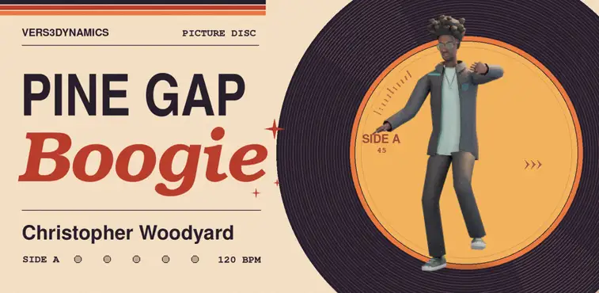

# Christopher Woodyard

**Artist, musician, and independent researcher.**

Some days my work starts in a sketchbook or recording studio. Other days it starts in a simulated world or with an experiment that didn't go as planned.

I write poetry, paint, and make music as [Indigo People](https://chriswoodyard.bandcamp.com/). I'm also the founder of [Vers3Dynamics](https://vers3dynamics.com/), my independent, open-source research lab. I explore sound, intelligent systems, biological rhythms, and a question I keep returning to: **what can the physical world teach us about the fact that we experience anything at all?**

<a href="https://cdn.jsdelivr.net/gh/topherchris420/topherchris420@2eda23df3508bc8192a8dfc6e0d24ed67549db53/assets/pine-gap-boogie/side-b.mp4">
  <picture>
    <source media="(prefers-reduced-motion: reduce)" srcset="assets/pine-gap-boogie/sleeve.webp">
    
  </picture>
</a>

[**Flip to Side B ♫**](https://cdn.jsdelivr.net/gh/topherchris420/topherchris420@2eda23df3508bc8192a8dfc6e0d24ed67549db53/assets/pine-gap-boogie/side-b.mp4) to hear one note from each track on my Indigo People album *Green Machine*. They land under my sneakers and ring out together on the scratch. [See the sample credits](assets/pine-gap-boogie/README.md) · [Download the animated 3D model](https://raw.githubusercontent.com/topherchris420/topherchris420/main/assets/pine-gap-boogie/pine-gap-boogie.glb).

I'm interested in art, science, education, the strange beauty of the natural world, and making things that invite people to wonder. I like an ambitious idea, but I care just as much about what the evidence actually says. Sometimes the most interesting result is the one that didn't work.

If you feel like exploring, you can [visit my portfolio, Vanta](https://mitpress.vercel.app/), [walk around my interactive studio](https://mitpress.vercel.app/studio), [listen to my music](https://chriswoodyard.bandcamp.com/), [watch a simulated life unfold](https://lop-nur-twin.vercel.app/live), or [play with a sound-and-biosignal experiment](https://topherchris420.github.io/circle/workbench.html). There's no right order.

I built HumanTouch for anyone who’s asked AI to clean up a paragraph and got back something that no longer sounded like them. [Try it in ChatGPT](https://chatgpt.com/plugins/plugin_asdk_app_6abeddf492188191a6d96c320e2c1315) or [open the standalone studio](https://huggingface.co/spaces/ciaochris/HumanTouch).

If something catches your imagination, say hello. You can [write to me](mailto:christopher@vers3dynamics.com) or explore the [open research and projects](docs/atlas.md).

*Five notes. One chord.*

  
  

A painting and a simulated instrument, two expressions of the same curiosity. [Explore the interactive studio](https://mitpress.vercel.app/studio). Images from Vanta, pinned to a specific source revision.

### An invitation to explore

I want these projects to give people an extraordinary perspective on an ordinary universe. The experience begins with curiosity, becomes an experiment, and ends with a clearer pattern or a better question. **Explore → Influence → Discover → Explore Again.** Not every world is meant to be controlled; some are worth watching because they continue without us. [Read the Vers3Dynamics experience philosophy](docs/EXPERIENCE_DESIGN.md).

<!--
For the curious reader who opened the source:

I've always found it strange that we spend our lives trying to understand the universe while rarely questioning the nature of the being attempting to understand it. We assume that we are conscious because we experience consciousness, that we are intelligent because we accumulate knowledge, and that we are free because we occasionally exercise preference. Yet how much of what we consider ourselves is simply the uninterrupted repetition of processes we neither initiated nor fully comprehend? Perhaps the most extraordinary thing about human existence is how ordinary it has become to all of us.
-->

---

## Choose a door

<strong>Explore the wider collection of projects</strong>

The [illustrated exhibition](docs/exhibition.md) is a guided tour. The [complete atlas](docs/atlas.md) includes the projects, their maturity labels, and links to their sources.

<!-- atlas:begin -->
<!-- Generated by tools/build_atlas.py from docs/atlas.json. -->

| Explore | Inside |
| --- | --- |
| **[Play a world](docs/exhibition.md#play-a-world)** | Explore virtual cities, simulations and autonomous agents. |
| **[Challenge an intelligent system](docs/exhibition.md#challenge-an-intelligent-system)** | Investigate decisions, authorization, uncertainty and security. |
| **[Hear the invisible](docs/exhibition.md#hear-the-invisible)** | Discover sound, molecular representations, frequency and resonance. |
| **[Explore a research lab](docs/exhibition.md#explore-a-research-lab)** | Inspect experiments, models, measurements and scientific results. |
| **[Use something practical](docs/exhibition.md#use-something-practical)** | Approachable software for homeowners, creators, device owners and researchers. |
| **[Discover the unusual](docs/exhibition.md#discover-the-unusual)** | Experimental inventions that resist easy categorization. |
| **[The artist's collection](docs/exhibition.md#one-practice-many-forms)** | Music, painting, writing and the portfolio that holds them. |

[**Browse the complete atlas →**](docs/atlas.md) · 30 current projects · 8 archived experiments and forks
<!-- atlas:end -->

## How I work

I choose the questions and what counts as evidence. My AI research system, R.A.I.N., helps propose and test ideas, but a working demonstration isn't the same as a scientific finding. The records include the experiments that didn't pass.

<strong>What does the research evidence say?</strong>

These are scoped findings, not blanket endorsements of a project. Read the [evidence ledger](experiments/README.md) for definitions, methods, and outcomes.

<!-- ledger:top-rung -->
**`SUPPORTED`, so far:** Project Ascent's DC house model met its nine preregistered criteria on held-out sales. Quantum Noise Profiler detected no within-sweep drift on one IBM device over two hours.

**`REPRODUCED`, so far:** nothing in the ledger meets its independent-reproduction definition.

*Reviewed 10 November 2026. The partial review covered ATLAS and Lop Nur Twin. The two supported results retain their 21 October review.*

For the longer illustrated introduction, with the original interactive exhibits, artwork, simulations, and recorded experiments, [read the full profile tour](docs/profile-longform.md).
