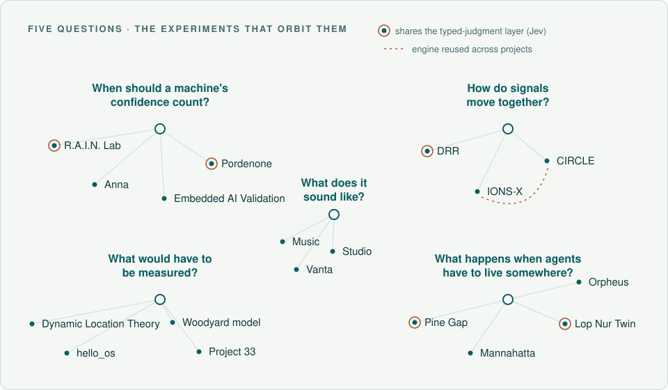

# The project map

[← Back to the profile](../README.md) · [Every public project](atlas.md) · [Evidence ledger](../experiments/README.md) · [Portfolio review](portfolio-review.md) · [Earlier experiments](../experiments/archive.md)

The work orbits five questions. The profile offers six doors and a few places to start, and [the atlas](atlas.md) lists every public project; this map keeps the research questions, and the approaches that failed, in view.

Across software, hardware designs, and games, one relationship keeps returning: a system proposes something, an inspectable process checks it, and the outcome stays on the record.

<picture>
  <source media="(prefers-color-scheme: dark)" srcset="../assets/constellations-dark.svg">
  <source media="(prefers-color-scheme: light)" srcset="../assets/constellations-light.svg">
  
</picture>

The illustration is the September 27, 2026 map. HumanTouch, James, TRIAD, Quantum Noise Profiler, Sentinel, GHOSTWHEEL, Jasmine, Project Ascent, Luca and Nocturne are included in the written map below; the profile's [connection diagram](../README.md#how-the-inventions-connect) places representative projects along six shared questions. The [13 October portfolio review](portfolio-review.md) records the editorial assessment of the projects in that review's GitHub subset; the 21 October review behind the redesigned profile read every public repository.

## When should a machine's confidence count?

A model may search, argue, score, or propose. A host policy, deterministic check, citation audit, or release gate decides what counts within its stated scope.

- **[R.A.I.N. Lab (current home: Lop Nur Twin)](https://github.com/topherchris420/lop-nur-twin)** — the four-perspective research runtime, literature corpus, decision constraints, research registry, experiment mechanisms, and Bethesda simulation now share one repository. The [migration record](https://github.com/topherchris420/lop-nur-twin/blob/main/docs/RAIN_MIGRATION.md) documents the TypeScript port from the earlier `james_library` runtime; that [former source](https://github.com/topherchris420/james_library) remains relevant to [dated historical experiments](https://github.com/topherchris420/james_library/blob/9c8811e343d21b8c143055f9cf549abdefa862f1/RESULTS.md), not as the current lab. The bounded autonomous experiment cycle runs locally under a human-authorized charter.
- **[rain-pipeline](https://github.com/topherchris420/rain-pipeline)** — a newer executable bridge from preregistered questions to pinned real-data runs, deterministic verdicts, verification, and replay. Its public record includes a failed confirmatory hypothesis; it is not retroactively promoted in the September evidence ledger.
- **[Pordenone / Resonate AI Mesh](https://github.com/topherchris420/resonate-ai-mesh)** — deterministic authorization gates, bounded judgment, fault-injection experiments, hash-chained decisions, offline replay, and counterfactuals. Its controlled results describe simulated worlds, not production deployments.
- **[James](https://github.com/topherchris420/james)** — a Rust desktop companion whose HTTP client can address only a loopback port. The model app controls where inference runs; James warns when it reports a cloud model. Explicit screen capture, one-use reviewed Windows input, and read-only R.A.I.N. context preserve the user's decision boundary. Recorded real-model workflows ran in a Linux container; physical Windows/macOS installation, actual reviewed input, accessibility, LM Studio, and end-user validation remain gaps. [Readiness record](https://github.com/topherchris420/james/blob/main/docs/END_USER_READINESS.md). Distinct from the archived `james_library` runtime.
- **[Anna](https://github.com/topherchris420/anna)** — self-hostable research search built on the architecture of Anna's Archive: hybrid retrieval, exact source offsets, and an explicit refusal when evidence is absent.
- **[Embedded AI Validation](https://github.com/topherchris420/embedded-ai-validation-platform)** — continuous integration for edge-AI firmware, with metrics labelled measured, simulated, estimated, or mock before they inform a release verdict.
- **[GHOSTWHEEL](https://github.com/topherchris420/ghostwheel)** — a browser simulator of fictional electric vehicles in which a command gateway accepts or refuses each steering request, requests a virtual safe state, and records the event for replay. Nine synthetic fault scenarios; a connector registry refuses any actuation transport other than simulation. No real vehicle is involved and no vulnerability is claimed. [Simulator](https://ghostwheel-one.vercel.app/).
- **[Jasmine](https://github.com/topherchris420/Jasmine)** — a self-hosted studio that turns a plain-language request into an AI workflow. A deterministic planner chooses the steps; a connected model may tailor wording but cannot add steps, and nothing is created until the user approves.

## How do signals move together?

Rhythm, lag, and coupling between changing signals. Controls and null models let a detector encounter something other than the pattern it was built to find.

- **[Dynamic Resonance Rooting](https://github.com/topherchris420/dynamic-resonance-rooting)** — recurring frequencies, lead–lag relationships, and structural-change diagnostics in multivariate time series. Synthetic calibration and a preregistered external result are reported separately. [External evidence](https://github.com/topherchris420/dynamic-resonance-rooting/blob/main/docs/external-evidence.md).
- **[CIRCLE](https://github.com/topherchris420/circle)** — a biosignal instrument design linking skin conductance, pulse, motion, and haptic feedback through timing and provenance. The signal pipeline and closed loop run against a simulated physiology twin. Hardware is designed, not built, and not cleared for fabrication or human connection. [Review gates](https://github.com/topherchris420/circle/blob/main/docs/review-gates.md).
- **[IONS-X](https://github.com/topherchris420/ions-x-deep-emergence-lab)** — sensing agents in a synthetic field, with paired coupled and uncoupled runs. [Experiment design](https://github.com/topherchris420/ions-x-deep-emergence-lab/blob/main/docs/experiment-design.md).

## What happens when agents have to live somewhere?

Places reconstructed from public sources become explorable worlds and bounded experiments. Source evidence, invented scenarios, and game outcomes retain their own records.

- **[Pine Gap: After Hours](https://github.com/topherchris420/satellite-vision-scape)** — a browser world with shared human/agent mechanics, a recorded live Jev journey, and paired scripted experiments that investigate failures. [Play](https://geotwn.vercel.app/) · [experiment method](https://github.com/topherchris420/satellite-vision-scape/blob/main/docs/EXPERIMENTS.md).
- **[Lop Nur Twin / Blacksite](https://github.com/topherchris420/lop-nur-twin)** — a public-source airfield reconstruction, a game and evaluation harness on shared geometry, and a hidden Bethesda environment containing a bounded R.A.I.N. autonomous research runtime. Source geography, simulated outcomes, and fictional events retain separate evidence classes. A model-versus-script comparison exposed a map exploit rather than model superiority. [Twin](https://lop-nur-twin.vercel.app/) · [Blacksite](https://lop-nur-twin.vercel.app/play) · [Research architecture](https://github.com/topherchris420/lop-nur-twin#how-the-research-loop-works).
- **[Mannahatta](https://github.com/topherchris420/cognisync-terrain-weaver)** — compare historical reconstruction, present land cover, and proposed green infrastructure. Route the same sealed storm before and after drawn interventions; export identities, assumptions, terrain and modeled results for checked replay. These are planning estimates. Its [holdout comparison](https://github.com/topherchris420/cognisync-terrain-weaver/blob/d797b189f7e2d8df9fa75df26e77246e52da0210/experiments/routing/R5-311-association-holdout/REPORT.md) did not beat low elevation in locating public street-flooding reports.
- **[Orpheus](https://github.com/topherchris420/orpheus-resonance-protocol)** — a control-room interface study. Local microphone energy is the real input; generated physiological values remain labelled.

## What would have to be measured?

Ideas written precisely enough to fail, beside code that distinguishes analytical, synthetic, and untested work. Papers become more useful when they specify the experiment that could change their conclusion.

- **[Quantum Noise Profiler](https://github.com/topherchris420/quantum-noise-profiler)** — qubit-noise monitoring with measurement provenance, declared session error budgets, dedicated readout probes, and fits/forecasts that can refuse insufficient evidence. Preregistered simulation follow-ups repaired earlier failures, and CUSUM matched operational performance. A preregistered two-hour pilot on IBM's `ibm_fez` (13–14 October 2026) then passed its within-sweep stability check and failed its constant-rate check; hardware warning accuracy is not established. [Results](https://github.com/topherchris420/quantum-noise-profiler/blob/192a8a0362dc9738b5bbb4a8f145447c1221c96a/results/V03_SUMMARY.md) · [Statistical assumptions](https://github.com/topherchris420/quantum-noise-profiler/blob/d888fa421b1a843608838935976730a6aea093ad/docs/SEQUENTIAL_METHODS.md).
- **[TRIAD](https://github.com/topherchris420/triad)** — when should a sensor refuse to answer, and when should any predictive system recognize that its evidence is insufficient? It began as a simulated capacitive sensor and widened, one frozen milestone at a time, to public datasets and to the claims people make about predictive systems. Every headline number is bound to the archived artifact that produced it and rechecked in CI. Its pre-registered Milestone 8 found its own evidence rules no better than blind comparators. [Research arc](https://github.com/topherchris420/triad#the-research-arc-machine-checked) · [Milestone 8](https://github.com/topherchris420/triad/blob/master/docs/metrology/milestone8-results.md).
- **[Dynamic Location Theory](https://doi.org/10.5281/zenodo.18263032)** — a proposal that position is encoded through resonance with a background scalar field, with atomic-clock and matter-wave interferometry predictions. The preprint is public; the paper repository and its simulation prototype have been private since October 2026. Predictions remain untested.
- **[Waveform (Woodyard model workstation)](https://waveform-teleportation.vercel.app/)** — a proposed scalar-field localization model simulated beside standard quantum baselines, with a stated falsification condition. The workstation runs publicly in the browser from analytical models; its source repository has been private since October 2026.
- **[Project Ascent](https://github.com/topherchris420/project-ascent)** — free home-price studios for covered DC and Maryland homes that expose every comparable sale and assumption. Each market model was scored once against thresholds fixed in code before a held-out year of recorded sales: the DC house model met all nine criteria, three narrowly; four other studies did not pass. Not an appraisal or financial advice. [Accuracy studies](https://github.com/topherchris420/project-ascent/blob/698e8fe8a345bf9a5522a0d8031a230775c14182/docs/valuation-validation.md).
- **[Luca](https://github.com/topherchris420/Luca)** — a Wi-Fi access point that records one device's traffic and checks it against indicators and heuristics, derived from Kaspersky's open-source TinyCheck. Its own addition is a kernel observatory that counts flows independently of the capture and labels each statement observed, correlated, inferred or unavailable. For devices and networks the user owns or may assess.
- **[Nocturne](https://github.com/topherchris420/nocturne)** — least-cost light-pollution plans that work backward from a sky-brightness target, with skyglow modelled per source and changes kept as owners' reversible actions. It controls no lights; DC figures are model estimates. [Evidence](https://github.com/topherchris420/nocturne/blob/90a988788b9a6b8ef77d0ff04e51b189f0e9269c/docs/EVIDENCE.md).
- **[hello_os](https://github.com/topherchris420/ideas)** — a toy model of gravitomagnetic rotor arrays, synthetic detector traces, and design sweeps bounded by material stress.
- **[Project 33](https://github.com/topherchris420/33)** — a folding-fin rocket bench testbed with simulation, CAD, firmware, and an interlocked launcher. Its evidence record tracks eight claims (on 21 October: 3 contradicted by their own models, 4 unresolved, 1 supported within stated limits) and no accepted physical measurement; no flight is claimed. [Project page](https://topherchris420.github.io/33/).

## What does it sound like?

Music, photography, painting, poetry, and software are ways of paying closer attention and giving an experience a form.

- **[Indigo People](https://chriswoodyard.bandcamp.com/)** — my recordings on Bandcamp.
- **[Sentinel](https://github.com/topherchris420/resonance-flow-nexus)** — sound generation, breathing visuals, adjustable pacing and local session reflection. An account-free creative experience, not a biometric measurement or validated therapy.
- **[Vers3Dynamics Studio](https://github.com/topherchris420/quantum-spin-sound)** — a browser synthesizer played by scratching a virtual record, with audio-reactive visuals. Its Strudel-style pattern editor is shown but not yet evaluated, so editing a note does not change the sound; the project says so itself. [Play](https://bell-labs.vercel.app/).
- **[Vanta](https://github.com/topherchris420/vanta)** — writing, instruments, worlds, art, and music as five channels in one portfolio, with a source-linked research atlas. [Explore](https://mitpress.vercel.app/).
- **[HumanTouch](https://huggingface.co/spaces/ciaochris/HumanTouch)** — a writing studio where a model may change expression but not silently change meaning, certainty, or facts. The change ledger, the guard that withholds certainty and number changes, and the authorship map are HumanTouch's own code, applied after any model. An offline evaluation calibrates those instruments on synthetic fixtures; a live model's edits are not yet measured.

## What didn't survive contact

Discarded approaches stay in view. The first five entries were recorded in the September 27 profile; the next two follow the linked experiment records reviewed September 30; the next five were added on October 12 and 13; the rest on October 21.

- **A structural-change claim.** On NOAA's QBO series, DRR exceeded its preregistered false-alarm tolerance. The claim remains `not_supported`. [Protocol and result](https://github.com/topherchris420/dynamic-resonance-rooting/blob/main/DRR_VALIDATION_REPORT.md).
- **Two firmware assumptions.** CIRCLE's physiological twin showed that the ADC has no native 64 SPS mode and optical timestamps must anchor to the FIFO interrupt rather than the read. [Pipeline methods](https://github.com/topherchris420/circle/blob/main/docs/physiology-pipeline.md).
- **A spring margin.** Project 33 states a requirement of at least 20% margin for its torsion spring; the calculation reports 19%. The claim stays unresolved. [Evidence observatory](https://github.com/topherchris420/33/blob/main/docs/EVIDENCE_OBSERVATORY.md).
- **An agent's habits.** Pine Gap's recorded route reviews did not change its plan, and many calls chose to wait. The revised task lets the runtime recognize when an activity is playing itself out. [Agent observations](https://github.com/topherchris420/satellite-vision-scape/blob/main/docs/NEXT_MODEL.md).
- **The language of 2025.** Early prototypes described “operational” wormhole stabilization and teleportation fidelity above 99.5%. Those descriptions were replaced with bounded questions and testable predictions. The archive preserves the earlier work. [Read the strata](../experiments/archive.md).
- **A citation assumption.** R.A.I.N.'s exact-span gate rejected genuine quotes after typography normalization. Its failed experiment and seeded rerun remain published beside the passing checks. [Results](https://github.com/topherchris420/james_library/blob/main/RESULTS.md).
- **An apparent model advantage.** In Blacksite, a simple marksman script matched Jev on the same seeds. The map made a stationary shooter difficult to threaten. The world was revised, and the remaining exploit stays documented. [Historical comparison and limits](https://github.com/topherchris420/lop-nur-twin/blob/f1dfe3f880c071f98836ab46edcce6f92641b613/README.md#the-result-that-changed-the-experiment).
- **Convergence as confidence.** In TRIAD's synthetic pilot, half of the position errors above 5 mm carried a successful optimizer convergence flag. A stopping condition is not evidence that an answer is right. [Research arc](https://github.com/topherchris420/triad#the-research-arc-machine-checked).
- **A better evidence judge.** TRIAD's claim-relative evidence rules lost a pre-registered test to a blind statistical reviewer on 5,078 real-outcome claims, and cost more than endorsing nothing. The method is not to be proposed as a contribution; repairs need a new frozen test. [Milestone 8 results](https://github.com/topherchris420/triad/blob/7be64c8c93f2ef3238ac18b386aa5bb81c214bbb/docs/metrology/milestone8-results.md).
- **Replay as numerical accuracy.** R.A.I.N.'s live Gemma oscillator experiment replayed but failed both analytic accuracy guards; its verdict remained inconclusive. [Retained record](https://github.com/topherchris420/lop-nur-twin/blob/b8400fdf3f676d6ee9e090760921eff7c419df22/docs/rea-research/evaluations/gemma-live/README.md).
- **A flood-ranking advantage.** Mannahatta's routed accumulation did not locate held-out street-flooding reports better than simple low elevation. [Holdout record](https://github.com/topherchris420/cognisync-terrain-weaver/blob/d797b189f7e2d8df9fa75df26e77246e52da0210/experiments/routing/R5-311-association-holdout/REPORT.md).
- **A uniquely better warning engine.** Quantum Noise Profiler's v0.3 repairs passed their simulation criteria, but calibrated CUSUM matched its operational performance. [Follow-up](https://github.com/topherchris420/quantum-noise-profiler/blob/d888fa421b1a843608838935976730a6aea093ad/results/V03_SUMMARY.md).

The entries below were added on 21 October.

- **A constant readout rate.** On real hardware, Quantum Noise Profiler's preregistered pilot found readout error moving between batches by more than its constant-rate model allows, in 6 of 10 probe series. [Pilot](https://github.com/topherchris420/quantum-noise-profiler/blob/192a8a0362dc9738b5bbb4a8f145447c1221c96a/results/V03_SUMMARY.md).
- **A changing field that wasn't.** IONS-X audited its own synthetic generator and found that the field behind every earlier result froze within about 100 frames and made its "transient" coupling permanent. The earlier benchmark is superseded, not deleted. [What version 0.5 found](https://github.com/topherchris420/ions-x-deep-emergence-lab/blob/99401c3e1a6ceed3f63cc8e3e606f164e13ff245/README.md#what-version-05-found-in-its-own-generator).
- **Judgment only where agents look unstable.** In Pordenone's seeded simulation, routing model judgment only to unstable agents saved 182 calls per run and let 2.55 more commits through on degraded evidence. [Experiments](https://github.com/topherchris420/resonate-ai-mesh/blob/8afc9de712331efdb1aece51ff60c7ca0dbb4244/docs/experiments.md).
- **Four of five price models.** Project Ascent's DC condominium, both Maryland and King County models missed their pre-registered acceptance on held-out sales; the failed studies stay published beside the one that passed. [Accuracy studies](https://github.com/topherchris420/project-ascent/blob/698e8fe8a345bf9a5522a0d8031a230775c14182/docs/valuation-validation.md).
- **Three of a rocket's eight claims.** Project 33's own models contradict its folding-fin mechanism, spring-margin and structural claims; no physical measurement has been accepted. [Claim record](https://github.com/topherchris420/33/blob/2ad7213e5fea06d1f21a20c020ada15467199c8d/README.md).
- **Streetlights as the whole story.** Nocturne's model shows streetlights are a minority of skyglow: removing about 60% of their after-midnight contribution moves the modeled DC sky by about 0.1 mag/arcsec². [Evidence](https://github.com/topherchris420/nocturne/blob/90a988788b9a6b8ef77d0ff04e51b189f0e9269c/docs/EVIDENCE.md).
- **Code that plays the score.** Vers3Dynamics Studio's own test, edit one note and hear the pitch change, fails: the pattern editor is not yet connected to the sound. [README](https://github.com/topherchris420/quantum-spin-sound/blob/d019ddf43cf2d33eb36babaa21fa32ee09642322/README.md).

[← Back to the profile](../README.md) · [Every public project](atlas.md) · [Where the experiments stand](../experiments/README.md)
